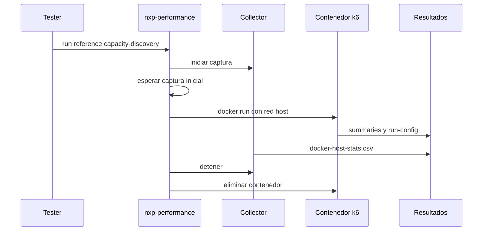

# Diseño Del Orchestrator De Capacity Discovery

## Overview

El orchestrator es un script Bash delgado que coordina dependencias del sistema, captura de metricas y ejecucion de k6. La logica de carga permanece en el adapter de referencia y en los perfiles k6.

## Architecture

## Components And Interfaces

- `nxp-performance`: contrato CLI, ciclo de vida y metadata del host.
- `k6/core/profiles`: define tasas, stages y thresholds.
- `k6/projects/reference/main.js`: entrypoint ejecutado por k6.
- `k6/scripts/collect-host-stats.sh`: captura observabilidad local.

## Configuration

- `NXP_K6_IMAGE`: imagen Docker de k6.
- `K6_CONTAINER_NAME`: nombre determinista del contenedor.
- `INITIAL_CAPTURE_SECONDS`: espera inicial.
- `RUN_ID`: identificador opcional.
- `RESULTS_DIR`: directorio opcional de salida.
- `BASE_URL`: URL de la API bajo prueba.

## Error Handling

- El uso invalido termina con codigo 2.
- La existencia previa del contenedor se trata como conflicto, no como permiso para reemplazarlo.
- La limpieza usa `trap` y no oculta el codigo de salida de k6.

## Testing Strategy

- Validar contrato CLI y errores de dependencias.
- Ejecutar una corrida controlada con servicios disponibles.
- Verificar artefactos, limpieza y codigo de salida.
- No usar este perfil para concluir capacidad productiva.
