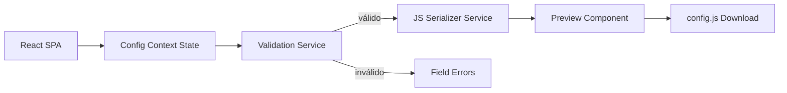
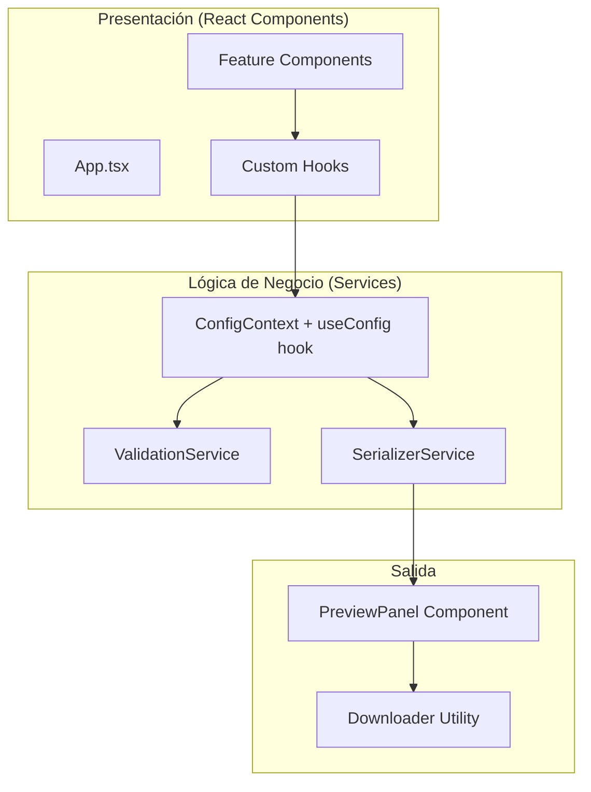
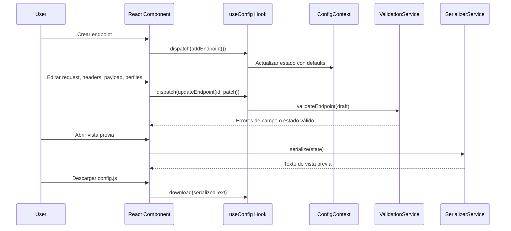
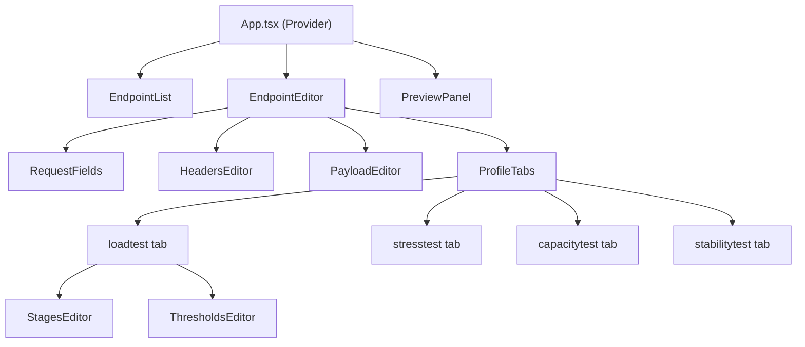
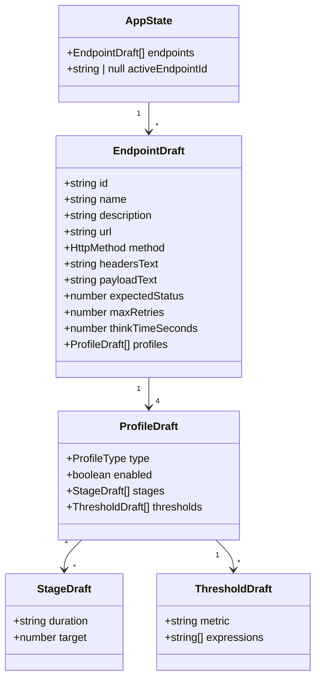
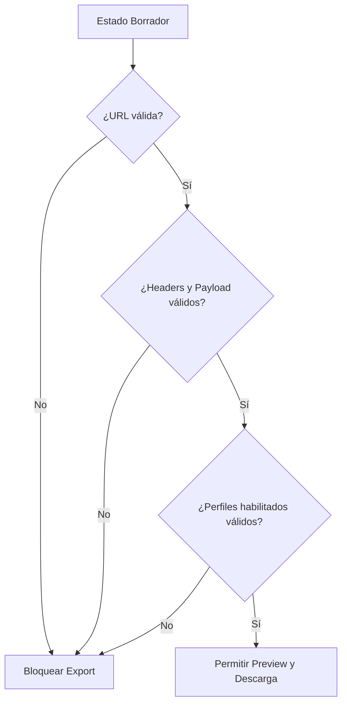

# Design: Config Builder UI

## Overview

El Config Builder UI es una aplicación web SPA construida con React + TypeScript + Vite que corre en el navegador sin backend. Su propósito es guiar a los testers en la creación de archivos `config.js` válidos para K6, eliminando la necesidad de editar JavaScript manualmente.

La aplicación mantiene un estado borrador en memoria (React state + context), valida los campos en tiempo real, serializa la configuración a JavaScript ES modules, muestra una vista previa del código generado y permite descargar el archivo `config.js` resultante.



La configuración generada es compatible con el import existente del runner K6:
```javascript
import config from "./config.js";
```

## Architecture

La arquitectura sigue un patrón de aplicación React de página única (SPA) con estado centralizado vía Context API y servicios puros de lógica de negocio desacoplados de la UI.

### Capas del Sistema



### Decisiones Arquitecturales

| Decisión | Justificación |
|----------|---------------|
| React 18+ con TypeScript | Componentes declarativos, tipado estricto, ecosistema maduro. |
| Vite como build tool | HMR rápido, configuración mínima, soporte nativo de TypeScript. |
| Context API para estado | Suficiente para v1 sin dependencias externas (sin Redux/Zustand). |
| Servicios puros separados | Lógica de validación y serialización testeable sin React. |
| CSS modules / vanilla CSS | Sin librerías de componentes externas en v1. Control total del layout. |
| Vitest + fast-check | Test runner natural del ecosistema Vite + PBT robusto. |
| Estado en memoria (no localStorage) | v1 descarta estado al recargar. Simplifica la implementación inicial. |
| Validación síncrona | Toda la validación es local, sin llamadas de red. Respuesta inmediata. |
| Serialización determinista | Claves ordenadas alfabéticamente + indentación 2 espacios. Salida reproducible. |

### Estructura de Archivos del Proyecto

```text
src/
├── main.tsx                          ← Entry point de React
├── App.tsx                           ← Componente raíz + providers
├── components/
│   ├── EndpointList/
│   │   ├── EndpointList.tsx          ← Lista lateral de endpoints
│   │   └── EndpointList.module.css
│   ├── EndpointEditor/
│   │   ├── EndpointEditor.tsx        ← Editor del endpoint activo
│   │   ├── RequestFields.tsx         ← URL, method, status, retries, thinkTime
│   │   ├── HeadersEditor.tsx         ← Editor JSON de headers
│   │   ├── PayloadEditor.tsx         ← Editor JSON de payload
│   │   └── EndpointEditor.module.css
│   ├── ProfileEditor/
│   │   ├── ProfileTabs.tsx           ← Tabs de perfiles con toggles
│   │   ├── StagesEditor.tsx          ← Lista de stages con drag/move
│   │   ├── ThresholdsEditor.tsx      ← Editor de métricas y expresiones
│   │   └── ProfileEditor.module.css
│   ├── PreviewPanel/
│   │   ├── PreviewPanel.tsx          ← Vista previa del config.js generado
│   │   ├── CommandSuggestions.tsx     ← Comandos k6 sugeridos
│   │   └── PreviewPanel.module.css
│   └── common/
│       ├── ConfirmDialog.tsx          ← Diálogo de confirmación reutilizable
│       ├── ValidationMessage.tsx      ← Mensaje de error inline
│       └── common.module.css
├── hooks/
│   ├── useConfig.ts                  ← Hook principal de acceso al contexto
│   ├── useValidation.ts              ← Hook de validación por campo
│   └── useDebounce.ts                ← Debounce para validación en 500ms
├── models/
│   ├── AppState.ts                   ← Interfaces de estado
│   ├── EndpointDraft.ts              ← Interface de endpoint borrador
│   ├── ProfileDraft.ts               ← Interface de perfil
│   ├── StageDraft.ts                 ← Interface de stage
│   ├── ThresholdDraft.ts             ← Interface de threshold
│   └── ValidationResult.ts           ← Tipos de resultado de validación
├── services/
│   ├── validation.service.ts         ← Lógica pura de validación
│   ├── serializer.service.ts         ← Serialización a JS ES module
│   └── defaults.service.ts           ← Valores por defecto
├── context/
│   ├── ConfigContext.tsx             ← Context + Provider del estado
│   └── configReducer.ts             ← Reducer de acciones sobre el estado
├── utils/
│   ├── downloader.ts                 ← Generación de Blob + link de descarga
│   └── constants.ts                  ← Métricas K6, límites, regex
└── assets/
    └── styles/
        └── global.css                ← Estilos globales
```

### Flujo de Interacción Principal



## Components and Interfaces

### Estructura de la UI



### Interfaces TypeScript del Modelo

```typescript
// src/models/AppState.ts
export interface AppState {
  endpoints: EndpointDraft[];
  activeEndpointId: string | null;
}

// src/models/EndpointDraft.ts
export interface EndpointDraft {
  id: string;
  name: string;
  description: string;
  url: string;
  method: HttpMethod;
  headersText: string;
  payloadText: string;
  expectedStatus: number;
  maxRetries: number;
  thinkTimeSeconds: number;
  profiles: ProfileDraft[];
}

export type HttpMethod = 'GET' | 'POST' | 'PUT' | 'PATCH' | 'DELETE';

// src/models/ProfileDraft.ts
export type ProfileType = 'loadtest' | 'stresstest' | 'capacitytest' | 'stabilitytest';

export interface ProfileDraft {
  type: ProfileType;
  enabled: boolean;
  stages: StageDraft[];
  thresholds: ThresholdDraft[];
}

// src/models/StageDraft.ts
export interface StageDraft {
  duration: string;
  target: number;
}

// src/models/ThresholdDraft.ts
export interface ThresholdDraft {
  metric: string;
  expressions: string[];
}

// src/models/ValidationResult.ts
export interface FieldError {
  endpointId: string;
  field: string;
  message: string;
}

export interface ValidationResult {
  valid: boolean;
  errors: FieldError[];
}
```

### Interfaces de Servicios

```typescript
// src/services/validation.service.ts
export interface IValidationService {
  validateEndpoint(draft: EndpointDraft): ValidationResult;
  validateField(fieldName: string, value: unknown, constraints: FieldConstraints): string | null;
  validateUrl(url: string): string | null;
  validateJson(text: string, requireObject?: boolean): string | null;
  validateDuration(duration: string): string | null;
  validateMetricName(name: string): string | null;
  validateExportReady(state: AppState): ValidationResult;
}

// src/services/serializer.service.ts
export interface ISerializerService {
  serialize(state: AppState): string;
  serializeEndpoint(draft: EndpointDraft): Record<string, unknown>;
  serializeProfile(profile: ProfileDraft): Record<string, unknown> | null;
}

// src/services/defaults.service.ts
export interface IDefaultsService {
  createEndpoint(existingNames: string[]): EndpointDraft;
  createStage(): StageDraft;
  duplicateEndpoint(source: EndpointDraft): EndpointDraft;
}
```

### Acciones del Reducer (Context)

```typescript
// src/context/configReducer.ts
export type ConfigAction =
  | { type: 'ADD_ENDPOINT' }
  | { type: 'UPDATE_ENDPOINT'; id: string; patch: Partial<EndpointDraft> }
  | { type: 'REMOVE_ENDPOINT'; id: string }
  | { type: 'DUPLICATE_ENDPOINT'; id: string }
  | { type: 'SET_ACTIVE_ENDPOINT'; id: string }
  | { type: 'ADD_STAGE'; endpointId: string; profileType: ProfileType }
  | { type: 'REMOVE_STAGE'; endpointId: string; profileType: ProfileType; stageIndex: number }
  | { type: 'REORDER_STAGES'; endpointId: string; profileType: ProfileType; fromIndex: number; toIndex: number }
  | { type: 'UPDATE_STAGE'; endpointId: string; profileType: ProfileType; stageIndex: number; patch: Partial<StageDraft> }
  | { type: 'TOGGLE_PROFILE'; endpointId: string; profileType: ProfileType }
  | { type: 'ADD_THRESHOLD'; endpointId: string; profileType: ProfileType; metric: string }
  | { type: 'REMOVE_THRESHOLD'; endpointId: string; profileType: ProfileType; metric: string }
  | { type: 'UPDATE_THRESHOLD_EXPRESSIONS'; endpointId: string; profileType: ProfileType; metric: string; expressions: string[] };
```

### Componentes React Principales

| Componente | Responsabilidad |
|------------|----------------|
| `App.tsx` | Provider del contexto, layout principal (sidebar + editor + preview) |
| `EndpointList` | Lista de endpoints, crear, duplicar, eliminar, seleccionar |
| `EndpointEditor` | Formulario del endpoint activo, agrupa sub-editores |
| `RequestFields` | Campos: URL, method, expectedStatus, maxRetries, thinkTimeSeconds |
| `HeadersEditor` | Textarea JSON con validación inline para headers |
| `PayloadEditor` | Textarea JSON con validación inline para payload |
| `ProfileTabs` | Tabs de 4 perfiles con toggle enable/disable |
| `StagesEditor` | Lista de stages con add, remove, reorder, edición inline |
| `ThresholdsEditor` | Selector de métricas + lista de expresiones por métrica |
| `PreviewPanel` | Vista previa del config.js + botón de descarga + comandos sugeridos |
| `ConfirmDialog` | Modal de confirmación reutilizable |
| `ValidationMessage` | Componente inline de error debajo de campos |

### Dirección Visual

Layout compacto operacional: lista de endpoints a la izquierda (sidebar), editor en el área principal, controles de revisión/exportación en panel lateral o barra de acción persistente. Sin diseño tipo marketing; es una herramienta de uso repetido para testing.

## Data Models

### Modelo de Estado



### Tipos Enumerados

```typescript
// HttpMethod
type HttpMethod = 'GET' | 'POST' | 'PUT' | 'PATCH' | 'DELETE';

// ProfileType
type ProfileType = 'loadtest' | 'stresstest' | 'capacitytest' | 'stabilitytest';
```

### Valores por Defecto de un Endpoint Nuevo

| Campo | Tipo | Valor por defecto |
|-------|------|-------------------|
| `id` | `string` | UUID generado |
| `name` | `string` | `"Endpoint N"` (N = siguiente disponible) |
| `url` | `string` | `""` (vacío, marcado inválido) |
| `method` | `HttpMethod` | `"POST"` |
| `headersText` | `string` | `'{ "Content-Type": "application/json" }'` |
| `payloadText` | `string` | `"{}"` |
| `expectedStatus` | `number` | `200` |
| `maxRetries` | `number` | `3` |
| `thinkTimeSeconds` | `number` | `1` |
| `profiles` | `ProfileDraft[]` | 4 perfiles (loadtest, stresstest, capacitytest, stabilitytest) todos deshabilitados |

### Valores por Defecto de un Stage Nuevo

| Campo | Tipo | Valor por defecto |
|-------|------|-------------------|
| `duration` | `string` | `"30s"` |
| `target` | `number` | `1` |

### Contrato de Salida (config.js)

La serialización genera un archivo con la estructura `export default { endpoints: [...] }`. Cada endpoint en la salida tiene la forma:

```javascript
{
  url: "https://...",
  payload: { /* objeto parseado del payloadText */ },
  headers: { /* objeto parseado del headersText */ },
  method: "POST",
  expectedStatus: 200,
  maxRetries: 3,
  thinkTimeSeconds: 1,
  // Solo perfiles habilitados:
  loadtest: {
    stages: [{ duration: "30s", target: 10 }, ...],
    thresholds: { metric: ["expresión", ...], ... }
  }
}
```

### Tabla de Métricas K6 Sugeridas

| Métrica | Descripción |
|---------|-------------|
| `http_req_duration` | Tiempo total de la solicitud HTTP |
| `http_req_failed` | Tasa de solicitudes fallidas |
| `http_reqs` | Número total de solicitudes |
| `http_req_waiting` | Tiempo esperando respuesta (TTFB) |
| `http_req_blocked` | Tiempo bloqueado antes de iniciar |
| `http_req_connecting` | Tiempo de conexión TCP |
| `http_req_receiving` | Tiempo recibiendo respuesta |
| `http_req_tls_handshaking` | Tiempo de handshake TLS |
| `http_req_sending` | Tiempo enviando solicitud |
| `iteration_duration` | Duración de una iteración completa |
| `iterations` | Número total de iteraciones |

Adicionalmente se permite cualquier métrica personalizada que cumpla el formato: 1–128 caracteres, solo letras, dígitos y guiones bajos.

### Estrategia de Validación

La validación ejecuta al editar (con debounce de 500ms) y antes de exportar. Los errores a nivel de campo se adjuntan al componente `ValidationMessage` más cercano. La exportación se bloquea si algún endpoint o perfil habilitado es inválido.



### Reglas de Serialización

- Los perfiles deshabilitados se omiten del output.
- Headers y payload se parsean desde el texto del editor antes de serializar.
- Las claves se ordenan alfabéticamente para determinismo.
- Indentación consistente de 2 espacios.
- Para `GET`, el payload se serializa como query params en la URL.
- Salida idéntica para entrada idéntica (sin timestamps ni aleatoriedad).


## Correctness Properties

*Una propiedad es una característica o comportamiento que debe cumplirse en todas las ejecuciones válidas de un sistema — esencialmente, una declaración formal sobre lo que el sistema debe hacer. Las propiedades sirven como puente entre especificaciones legibles por humanos y garantías de correctitud verificables por máquina.*

### Property 1: Validación de campos numéricos y URL

*Para cualquier* valor de campo (`expectedStatus`, `maxRetries`, `thinkTimeSeconds`, `target`) y cualquier string de URL, el validador debe aceptar el valor si y solo si está dentro de su rango definido (expectedStatus: 100–599, maxRetries: 0–10, thinkTimeSeconds: 0–60, target: 0–10000) y la URL comienza con `http://` o `https://`. Los métodos deben restringirse exclusivamente a `GET`, `POST`, `PUT`, `PATCH`, `DELETE`.

**Validates: Requirements 3.1, 3.2, 3.7, 3.8**

### Property 2: Validación JSON de headers y payload

*Para cualquier* string de entrada, la validación de headers debe aceptar el string si y solo si es JSON parseable a un objeto (no array, no primitivo, no malformado). La validación de payload debe aceptar el string si y solo si es JSON válido de cualquier tipo.

**Validates: Requirements 3.3, 3.4**

### Property 3: Validación de formato de duración K6 y nombre de métrica

*Para cualquier* string de duración, el validador debe aceptarlo si y solo si coincide con el formato de tiempo K6 (ej., "30s", "2m", "1h"). *Para cualquier* string de nombre de métrica personalizada, debe aceptarse si y solo si tiene entre 1 y 128 caracteres compuestos exclusivamente de letras, dígitos y guiones bajos.

**Validates: Requirements 4.3, 4.4, 5.3**

### Property 4: Serialización produce JavaScript sintácticamente válido

*Para cualquier* estado de configuración que pase la validación de export-readiness, la serialización debe producir un string que sea JavaScript ES module sintácticamente válido (parseable sin errores).

**Validates: Requirements 6.1**

### Property 5: Serialización es determinista (idempotente)

*Para cualquier* estado de configuración válido, serializar el mismo estado dos veces consecutivas debe producir resultados byte-por-byte idénticos, con indentación de 2 espacios y claves ordenadas alfabéticamente.

**Validates: Requirements 6.4**

### Property 6: Identidad entre preview y download

*Para cualquier* estado de configuración válido, el contenido mostrado en la vista previa debe ser byte-por-byte idéntico al contenido del archivo descargado.

**Validates: Requirements 6.2**

### Property 7: Export-readiness bloquea estados inválidos

*Para cualquier* estado de configuración, la acción de exportar/descargar debe estar bloqueada si se cumple al menos una de estas condiciones: no hay endpoints, algún endpoint tiene URL vacía o inválida, algún campo numérico está fuera de rango, headers no son objeto JSON, payload no es JSON válido, ningún perfil está habilitado en algún endpoint, un perfil habilitado tiene 0 stages, alguna expresión de threshold está vacía, o alguna métrica agregada no tiene expresiones.

**Validates: Requirements 6.3, 2.5, 4.7, 4.8, 5.4, 5.6, 7.8, 7.9**

### Property 8: Perfiles deshabilitados se omiten de la salida

*Para cualquier* endpoint con una combinación de perfiles habilitados y deshabilitados, la salida serializada debe contener exactamente los perfiles habilitados y ninguno de los deshabilitados.

**Validates: Requirements 4.6**

### Property 9: El orden de stages se preserva en la serialización

*Para cualquier* perfil habilitado con stages, y cualquier permutación aplicada al orden de esos stages, la serialización debe reflejar exactamente el orden actual (post-reordenamiento) de los stages.

**Validates: Requirements 4.5**

### Property 10: Serialización de GET con query params

*Para cualquier* endpoint con método `GET` y un payload que sea un objeto JSON con pares clave-valor, la serialización debe producir una URL con los pares clave-valor codificados como query parameters.

**Validates: Requirements 3.5**

### Property 11: Duplicación preserva todos los campos

*Para cualquier* endpoint, duplicarlo debe producir un nuevo endpoint con id diferente, etiqueta modificada indicando copia, y todos los demás campos (url, method, headers, payload, profiles, stages, thresholds) idénticos al original. Modificar la copia no debe afectar al original.

**Validates: Requirements 2.3**

### Property 12: Defaults correctos en creación

*Para cualquier* endpoint recién creado, sus valores por defecto deben ser: method=`POST`, headersText=`{ "Content-Type": "application/json" }`, payloadText=`{}`, expectedStatus=200, maxRetries=3, thinkTimeSeconds=1, url=vacía. *Para cualquier* stage recién creado, sus defaults deben ser: duration=`"30s"`, target=1.

**Validates: Requirements 7.1, 7.2, 7.3, 7.4, 7.5, 7.6, 7.7, 7.8**

### Property 13: Thresholds se serializan como arrays de strings

*Para cualquier* conjunto de thresholds de un perfil habilitado, la serialización debe producir un objeto donde cada clave es el nombre de la métrica y cada valor es un array de strings en formato de threshold K6.

**Validates: Requirements 5.5**

### Property 14: Límites de colección

*Para cualquier* secuencia de operaciones de creación, el sistema no debe permitir más de 50 endpoints, más de 20 stages por perfil, ni más de 10 expresiones por métrica de threshold. Intentar agregar más allá del límite debe ser rechazado o ignorado.

**Validates: Requirements 2.1, 4.2, 5.2**

### Property 15: Comandos sugeridos por perfil habilitado

*Para cualquier* estado de configuración válido con perfiles habilitados, el sistema debe mostrar exactamente un comando `k6 run -e TEST_TYPE=<profile> performancetest.js` por cada tipo de perfil que esté habilitado en al menos un endpoint.

**Validates: Requirements 6.5**

## Error Handling

### Estrategia General de Errores

La aplicación maneja errores exclusivamente en el lado del cliente ya que no hay backend. Los errores se clasifican en:

| Categoría | Comportamiento | Ejemplo |
|-----------|----------------|---------|
| Validación de campo | Error inline (componente `ValidationMessage`) junto al campo, dentro de 500ms del cambio | URL vacía, JSON malformado |
| Validación de export | Bloqueo del botón de descarga + listado de errores pendientes | Perfil sin stages |
| Error de parseo de JSON | Mensaje descriptivo en el campo correspondiente | `{invalid` en headers |
| Error de límite | Mensaje indicando el máximo permitido | >50 endpoints |
| Incompatibilidad de navegador | Mensaje de pantalla completa (fallback sin React) | Sin soporte ES modules |

### Errores de Validación de Campo

- Se ejecutan con debounce de 500ms vía `useDebounce` hook al cambiar valor.
- Se muestran como componentes `ValidationMessage` inline debajo del campo afectado.
- Se limpian automáticamente cuando el valor vuelve a ser válido.
- No bloquean la edición de otros campos.
- El estado de errores se mantiene en el contexto o en estado local del componente editor.

### Errores de Export-Readiness

- Se evalúan ejecutando `validateExportReady(state)` antes de generar la vista previa.
- Bloquean las acciones de preview y descarga (botón deshabilitado).
- Se presentan como un resumen listando todos los errores pendientes en el `PreviewPanel`.
- Incluyen referencia al endpoint y campo específico con error.

### Errores de Límites

- Al intentar crear el endpoint #51, el reducer ignora la acción y el componente muestra un mensaje indicando el máximo de 50.
- Al intentar agregar el stage #21, se muestra un mensaje indicando el máximo de 20 por perfil.
- Al intentar agregar la expresión #11, se muestra un mensaje indicando el máximo de 10 por métrica.
- Los límites se validan en el reducer antes de modificar el estado.

### Manejo de Valores por Defecto Limpiados

- Si el usuario borra un campo que tiene valor por defecto (`method`, `expectedStatus`, `maxRetries`, `thinkTimeSeconds`), el hook `useValidation` emite error de validación inmediato.
- El campo no se restaura automáticamente al default; queda en estado de error hasta que el usuario ingrese un valor válido.

## Testing Strategy

### Enfoque Dual de Testing

La estrategia de pruebas combina tests de ejemplo (unit tests) para escenarios específicos con tests basados en propiedades (property-based tests) para verificar invariantes universales.

### Stack de Testing

| Herramienta | Rol |
|-------------|-----|
| **Vitest** | Test runner principal (compatible con Vite, soporte nativo de TypeScript) |
| **fast-check** | Librería de property-based testing |
| **React Testing Library** | Testing de componentes React (render, queries, user events) |
| **jsdom** | Entorno DOM para Vitest |

### Unit Tests (Ejemplo)

Los unit tests se escriben con Vitest + React Testing Library y cubren:
- **Estado inicial**: App arranca con lista vacía y botón de crear visible (1.2)
- **Interacciones UI**: Seleccionar endpoint muestra detalles (2.2), eliminar con confirmación (2.4)
- **Renderizado de perfiles**: 4 toggles presentes al abrir editor (4.1)
- **Sugerencias de métricas**: Lista completa de métricas K6 disponible (5.1)
- **Reducer**: Cada acción del `configReducer` produce el estado esperado
- **Servicios puros**: `ValidationService` y `SerializerService` con inputs específicos

### Property-Based Tests

Librería seleccionada: **fast-check** (integrado con Vitest, TypeScript nativo).

Configuración: mínimo 100 iteraciones por propiedad (`numRuns: 100`).

Cada test de propiedad está etiquetado con formato:
**Feature: config-builder-ui, Property {number}: {descripción}**

Las propiedades a implementar como tests PBT son las 15 propiedades definidas en la sección Correctness Properties, cubriendo:

| Propiedad | Área | Generadores Principales |
|-----------|------|------------------------|
| 1 | Validación de campos | Enteros aleatorios, strings de URL |
| 2 | Validación JSON | Strings JSON/no-JSON aleatorios |
| 3 | Formato duración K6 y métricas | Strings aleatorios |
| 4 | Serialización válida | Estados `AppState` válidos aleatorios |
| 5 | Determinismo | Estados `AppState` válidos aleatorios |
| 6 | Preview = Download | Estados válidos aleatorios |
| 7 | Export-readiness | Estados con errores inyectados aleatoriamente |
| 8 | Perfiles deshabilitados | Estados con combinaciones de enabled/disabled |
| 9 | Orden de stages | Stages + permutaciones aleatorias |
| 10 | GET query params | Objetos JSON con pares clave-valor aleatorios |
| 11 | Duplicación | Endpoints con campos aleatorios |
| 12 | Defaults | Secuencias de creación |
| 13 | Thresholds como arrays | Thresholds aleatorios |
| 14 | Límites de colección | Secuencias de N operaciones |
| 15 | Comandos sugeridos | Combinaciones de perfiles habilitados |

### Integration Tests

Cubren flujos end-to-end con React Testing Library + Vitest:
- Crear endpoint → editar campos → habilitar perfil → agregar stages → preview → descargar
- Persistencia de estado durante navegación interna (1.3)
- Estado fresco tras recarga (1.4)
- Validación se ejecuta dentro de 500ms (3.6)

### Estructura de Archivos de Test

```text
tests/
├── properties/
│   ├── validation.property.test.ts    (Properties 1, 2, 3, 7)
│   ├── serialization.property.test.ts (Properties 4, 5, 6, 8, 9, 10, 13)
│   └── state.property.test.ts         (Properties 11, 12, 14, 15)
├── unit/
│   ├── validation.service.test.ts     (Unit tests de ValidationService)
│   ├── serializer.service.test.ts     (Unit tests de SerializerService)
│   ├── defaults.service.test.ts       (Unit tests de DefaultsService)
│   ├── configReducer.test.ts          (Unit tests del reducer)
│   └── components/
│       ├── EndpointList.test.tsx       (Tests de componente)
│       ├── EndpointEditor.test.tsx
│       ├── ProfileTabs.test.tsx
│       └── PreviewPanel.test.tsx
└── integration/
    └── configBuilder.integration.test.tsx  (Tests E2E del flujo completo)
```

### Configuración de Vitest

```typescript
// vitest.config.ts (referencia)
import { defineConfig } from 'vitest/config';
import react from '@vitejs/plugin-react';

export default defineConfig({
  plugins: [react()],
  test: {
    environment: 'jsdom',
    include: ['tests/**/*.test.{ts,tsx}'],
    coverage: {
      include: ['src/**/*.{ts,tsx}'],
      exclude: ['src/main.tsx'],
    },
  },
});
```
