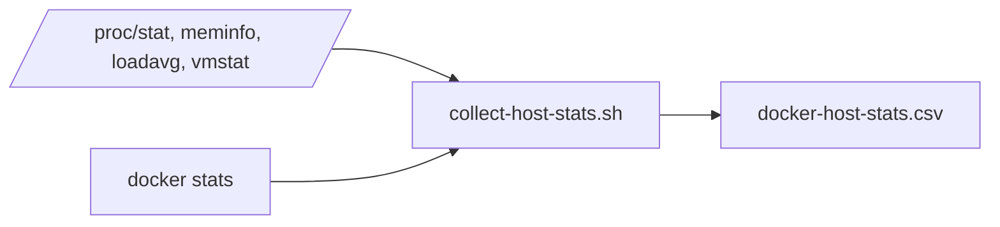

# Diseño Del Collector De Observabilidad Local

## Overview

El collector es un script Bash sin servicio adicional. Lee `/proc`, calcula deltas entre muestras y consulta `docker stats --no-stream`. La salida se almacena en un CSV local.

## Architecture

## Components And Interfaces

- `read_host_cpu`: obtiene contadores acumulados de CPU.
- `read_host_memory`: calcula memoria y swap en MiB.
- `read_host_load`: obtiene load average.
- `read_swap_activity`: obtiene contadores de swap.
- `docker stats`: aporta consumo por contenedor.
- `DOCKER_CONTAINERS`: permite configurar objetivos.
- `K6_CONTAINER_NAME`: identifica el contenedor de k6.

## Data Model

La cabecera CSV contiene timestamp, metricas del host, nombre del contenedor, metricas Docker y estado. Las celdas no disponibles permanecen vacias y el estado explica la ausencia.

## Error Handling

- Sin Docker, el collector termina con error explicito.
- Si `docker stats` falla durante una muestra, el collector continua y registra los objetivos como ausentes.
- Los deltas no validos se dejan vacios en lugar de generar valores artificiales.

## Testing Strategy

- Validar cabecera y numero de columnas.
- Ejecutar el script con duracion corta.
- Verificar estados `OK`, `MISSING` y `NOT_DETECTED` en un entorno con Docker disponible.
- Verificar que las metricas de swap no sean confundidas con memoria usada.
