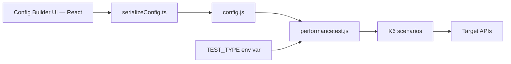
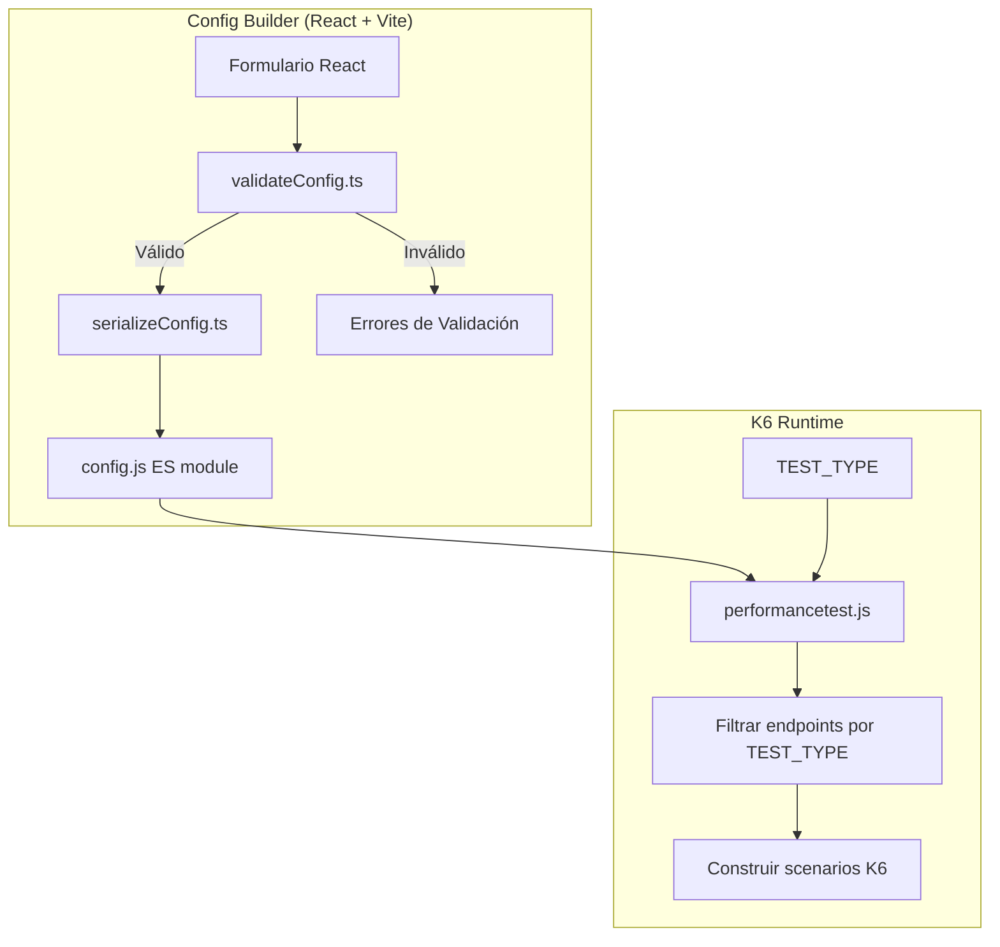
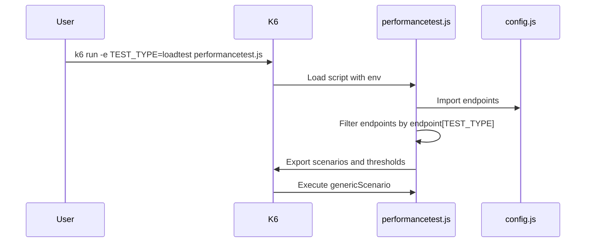
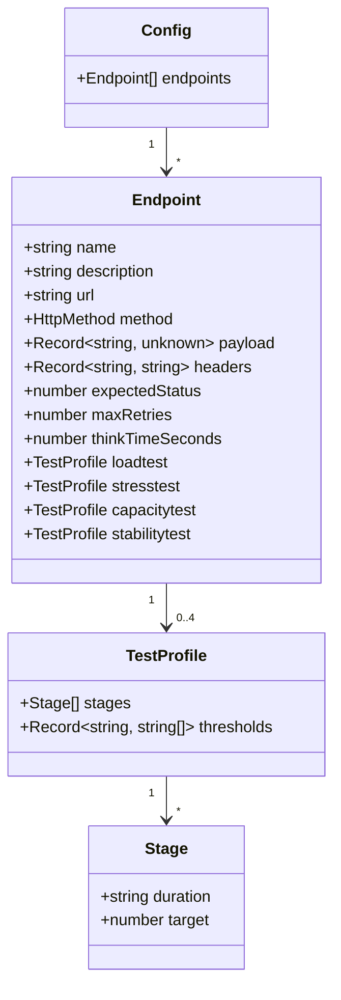
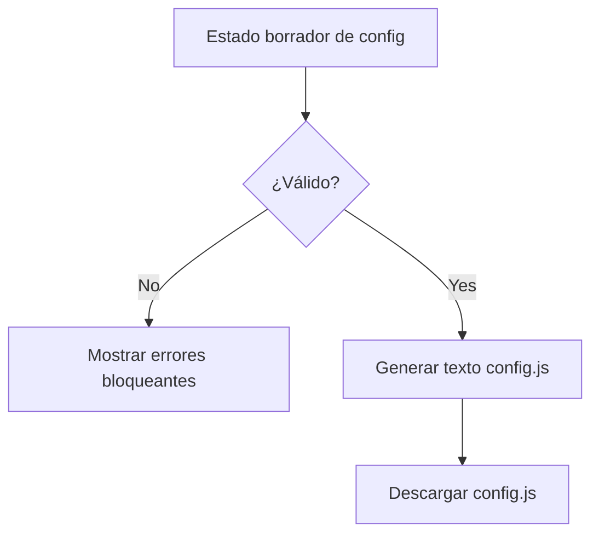

# Design: K6 Config Contract

## Overview

El contrato de configuración permanece como un módulo ES consumido por `performancetest.js`. La futura UI (React + TypeScript + Vite) serializa la entrada del usuario en este contrato, mientras K6 continúa seleccionando endpoints mediante `TEST_TYPE`.

La implementación se realiza en TypeScript (`src/services/`), compilada y bundled por Vite. El output final (`config.js`) sigue siendo un archivo JavaScript ES module que el runner importa directamente. La validación ocurre antes de la generación del archivo, garantizando que solo configuraciones válidas lleguen al runner.



## Architecture

El sistema sigue una arquitectura de pipeline lineal con tres componentes principales separados por responsabilidad, implementados en TypeScript:

1. **Validación** (`src/services/validateConfig.ts`) — verifica la integridad del input del usuario antes de cualquier serialización.
2. **Serialización** (`src/services/serializeConfig.ts`) — transforma el modelo de datos validado en texto JavaScript ES module.
3. **Consumo** — el runner K6 importa el archivo generado (`config.js`) y construye escenarios dinámicamente.



### Decisiones de Arquitectura

| Decisión | Justificación |
|----------|---------------|
| Implementación en TypeScript | Type safety en compilación; interfaces compartidas entre validación, serialización y UI |
| Validación separada de serialización | Permite reportar errores antes de generar el archivo; facilita testing unitario |
| Output como JavaScript ES module | Compatibilidad directa con `import config from "./config.js"` del runner existente |
| Perfiles opcionales por endpoint | El runner ya usa `endpoint[TEST_TYPE]` para filtrar; perfiles ausentes son ignorados naturalmente |
| Métricas custom preservadas como strings | El runner las define como `new Trend(...)` / `new Counter(...)` y referencia por nombre exacto |
| Vitest + fast-check para testing | Stack natural del ecosistema Vite; fast-check provee PBT robusto en TypeScript |

### Secuencia de Generación



## Components and Interfaces

### Tipos compartidos (`src/models/config.types.ts`)

```typescript
export interface Config {
  endpoints: Endpoint[];
}

export interface Endpoint {
  url: string;
  method: HttpMethod;
  payload?: Record<string, unknown>;
  headers?: Record<string, string>;
  expectedStatus: number;
  maxRetries: number;
  thinkTimeSeconds: number;
  name?: string;
  description?: string;
  loadtest?: TestProfile;
  stresstest?: TestProfile;
  capacitytest?: TestProfile;
  stabilitytest?: TestProfile;
}

export type HttpMethod = "GET" | "POST" | "PUT" | "PATCH" | "DELETE";

export type ProfileName = "loadtest" | "stresstest" | "capacitytest" | "stabilitytest";

export interface TestProfile {
  stages: Stage[];
  thresholds?: Record<string, string[]>;
}

export interface Stage {
  duration: string;
  target: number;
}
```

### Módulo de Validación (`src/services/validateConfig.ts`)

Responsable de verificar que una configuración cumple el contrato antes de la serialización.

```typescript
export interface ValidationResult {
  valid: boolean;
  errors: ValidationError[];
}

export interface ValidationError {
  path: string;       // e.g. "endpoints[0].url"
  rule: string;       // e.g. "required", "invalid_method"
  message: string;    // Mensaje legible
}

export function validateConfig(config: Config): ValidationResult;
export function validateEndpoint(endpoint: Endpoint, index: number): ValidationError[];
export function validateTestProfile(
  profile: TestProfile,
  profileName: ProfileName,
  endpointIndex: number
): ValidationError[];
export function validateStage(stage: Stage, stageIndex: number, path: string): ValidationError[];
```

### Módulo de Serialización (`src/services/serializeConfig.ts`)

Transforma el objeto de configuración validado en texto JavaScript ES module.

```typescript
export function serializeConfig(config: Config): string;
```

**Contrato de salida:**
- Produce texto JavaScript sintácticamente válido.
- Incluye `export default { endpoints: [...] }`.
- Preserva todos los campos del endpoint y perfiles.
- Produce output determinista y legible (indentado con 2 espacios).

### Interfaz entre Serializer y Runner

El runner consume el archivo generado mediante:

```javascript
import config from "./config.js";
const endpoints = config.endpoints.filter(ep => ep[scenarioName]);
```

No existe acoplamiento adicional. El runner accede a campos conocidos del contrato sin transformación.

## Data Models



### Forma Generada

```js
export default {
  endpoints: [
    {
      name: "Create resource",
      description: "Creates a generic resource",
      url: "https://api.example.com/v1/resources",
      method: "POST",
      payload: {},
      headers: {
        "Content-Type": "application/json"
      },
      expectedStatus: 200,
      maxRetries: 3,
      thinkTimeSeconds: 1,
      loadtest: {
        stages: [
          { duration: "30s", target: 10 },
          { duration: "2m", target: 10 },
          { duration: "30s", target: 0 }
        ],
        thresholds: {
          http_req_duration: ["p(95) < 2000"],
          http_req_failed: ["rate < 0.01"]
        }
      }
    }
  ]
};
```

### Campos del Endpoint

| Campo | Tipo | Requerido | Descripción |
|-------|------|-----------|-------------|
| `url` | string | Sí | URL absoluta del API target |
| `method` | HttpMethod | Sí | GET, POST, PUT, PATCH, DELETE |
| `payload` | Record<string, unknown> | No | Body del request (JSON válido) |
| `headers` | Record<string, string> | No | Headers HTTP como key-value |
| `expectedStatus` | number | Sí | Status HTTP esperado (100-599) |
| `maxRetries` | number | Sí | Reintentos máximos en stress |
| `thinkTimeSeconds` | number | Sí | Pausa entre iteraciones |
| `name` | string | No | Nombre descriptivo (metadata) |
| `description` | string | No | Descripción de la transacción (metadata) |

### Campos del TestProfile

| Campo | Tipo | Requerido | Descripción |
|-------|------|-----------|-------------|
| `stages` | Stage[] | Sí | Al menos un stage |
| `thresholds` | Record<string, string[]> | No | Objeto metric-keyed con arrays de expresiones |

### Campos del Stage

| Campo | Tipo | Requerido | Descripción |
|-------|------|-----------|-------------|
| `duration` | string | Sí | Duración K6 (e.g. "30s", "2m") |
| `target` | number | Sí | VUs objetivo (≥ 0) |

### Métricas Custom del Proyecto

Estas métricas son definidas por el runner y deben preservarse exactamente en los threshold keys:

- `waiting_time` (Trend)
- `Errors` (Counter)
- `Total_Reqs` (Counter)
- `retries` (Counter)
- `transaction_duration` (Trend)
- `transactions_per_second` (Trend)
- `active_vus` (Trend)

## Correctness Properties

*Una propiedad es una característica o comportamiento que debe ser verdadero en todas las ejecuciones válidas de un sistema — esencialmente, una declaración formal sobre lo que el sistema debe hacer. Las propiedades sirven como puente entre especificaciones legibles por humanos y garantías de corrección verificables por máquinas.*

### Property 1: Round-trip de serialización

*For any* configuración válida (Config con endpoints, perfiles, stages y thresholds), serializar a texto JavaScript y luego parsear/evaluar ese texto debe producir un objeto estructuralmente equivalente al original.

**Validates: Requirements 1.1, 1.2, 2.1, 2.2, 2.3, 2.4, 2.5, 2.6, 4.1, 4.2, 4.3, 4.4**

### Property 2: Preservación selectiva de perfiles

*For any* endpoint con un subconjunto arbitrario de perfiles configurados (entre 0 y 4 perfiles), el output serializado debe contener exactamente los perfiles configurados y omitir los no configurados.

**Validates: Requirements 3.1, 3.2, 3.3, 3.4, 3.6**

### Property 3: Preservación exacta de metric keys

*For any* conjunto de thresholds con metric keys (built-in o custom, incluyendo `waiting_time`, `Errors`, `Total_Reqs`, `retries`, `transaction_duration`, `transactions_per_second`, `active_vus`), la serialización debe preservar cada key exactamente como fue proporcionado, sin alteración de capitalización o formato.

**Validates: Requirements 4.5, 6.1, 6.2, 6.3, 6.4**

### Property 4: Rechazo de configuraciones inválidas

*For any* configuración que contenga al menos una violación del contrato (URL vacía/no-absoluta, método no soportado, headers no-objeto, payload no-JSON, status fuera de rango, perfil sin stages, stage con duration vacío o target negativo, expresión de threshold vacía), la función de validación debe retornar `valid: false`.

**Validates: Requirements 5.1, 5.2, 5.3, 5.4, 5.5, 5.6, 5.7, 5.8**

### Property 5: Aceptación de configuraciones válidas

*For any* configuración que cumpla todas las reglas del contrato (URL absoluta, método soportado, headers objeto, payload JSON válido, status 100-599, perfiles con al menos un stage válido, stages con duration no-vacío y target ≥ 0, expresiones de threshold no-vacías), la función de validación debe retornar `valid: true`.

**Validates: Requirements 5.1, 5.2, 5.3, 5.4, 5.5, 5.6, 5.7, 5.8**

## Error Handling

### Validación Pre-Exportación

La validación ocurre en el config builder antes de generar el archivo. El runner puede fallar rápido si un archivo editado manualmente viola el contrato.



### Reglas de Validación

| Regla | Campo | Condición de Rechazo |
|-------|-------|---------------------|
| URL requerida | `url` | Vacío o no URL absoluta |
| Método soportado | `method` | No es GET/POST/PUT/PATCH/DELETE |
| Headers tipo objeto | `headers` | No es un objeto JSON plano |
| Payload JSON válido | `payload` | No es JSON parseable |
| Status en rango | `expectedStatus` | Fuera de 100-599 |
| Stages requeridos | `stages` | Array vacío en perfil seleccionado |
| Stage válido | `duration`/`target` | Duration vacío o target < 0 |
| Threshold no vacío | threshold expressions | String vacío en array de reglas |

### Comportamiento de Errores

- **Errores de validación**: Se acumulan todos los errores antes de reportar (no fail-fast parcial). Se presenta la lista completa al usuario.
- **Errores de runtime K6**: Si un archivo editado manualmente no cumple el contrato, el runner falla con mensaje descriptivo (comportamiento existente: `throw new Error(...)`).
- **Campos opcionales ausentes**: No generan error. `name`, `description`, perfiles no configurados se omiten silenciosamente.
- **Errores de tipo en compilación**: TypeScript strict mode detecta violaciones de interfaz antes de runtime.

## Testing Strategy

### Enfoque Dual de Testing

Se emplea una estrategia combinada de tests unitarios y tests basados en propiedades:

- **Tests unitarios** (`tests/unit/`): Verifican ejemplos específicos, edge cases y condiciones de error.
- **Tests de propiedades** (`tests/properties/`): Verifican propiedades universales a través de inputs generados aleatoriamente.
- **Tests de integración** (`tests/integration/`): Verifican compatibilidad del output con el runner K6.

### Stack de Testing

| Herramienta | Propósito |
|-------------|-----------|
| [Vitest](https://vitest.dev/) | Test runner — ecosistema Vite, soporte nativo TypeScript |
| [fast-check](https://github.com/dubzzz/fast-check) | Librería PBT — generación de inputs aleatorios |

### Property-Based Testing

**Configuración**:
- Test runner: Vitest
- Librería PBT: fast-check
- Mínimo 100 iteraciones por test de propiedad.
- Cada test de propiedad referencia su propiedad del documento de diseño.
- Formato de tag: **Feature: k6-config-contract, Property {number}: {texto}**

**Archivos de property tests**:
- `tests/properties/config-contract.property.test.ts`
- `tests/properties/generators.ts` (generadores fast-check)

**Generadores necesarios** (`tests/properties/generators.ts`):
- `arbConfig`: genera objetos `Config` válidos con endpoints aleatorios.
- `arbEndpoint`: genera endpoints con campos válidos aleatorios.
- `arbTestProfile`: genera perfiles con stages y thresholds aleatorios.
- `arbStage`: genera stages con duration válido y target ≥ 0.
- `arbThresholds`: genera objetos de thresholds con keys de métricas aleatorias.
- `arbInvalidConfig`: genera configuraciones con al menos una violación.

### Tests Unitarios

**Ubicación**: `tests/unit/validateConfig.test.ts`, `tests/unit/serializeConfig.test.ts`

- Verificar ejemplo concreto basado en el `config.js` existente del proyecto.
- Verificar que metadata opcional (`name`, `description`) no rompe la estructura.
- Verificar que el output es determinista (mismo input → mismo output).
- Verificar cada regla de validación con inputs específicos.

### Tests de Integración

**Ubicación**: `tests/integration/runner-compat.test.ts`

- Importar archivo generado y verificar que `config.endpoints` es consumible.
- Ejecutar filtrado por `endpoint[TEST_TYPE]` con cada tipo soportado.
- Verificar compatibilidad con métricas custom del runner.

### Cobertura por Propiedad

| Propiedad | Tipo de Test | Archivo | Iteraciones |
|-----------|-------------|---------|-------------|
| P1: Round-trip serialización | PBT | `tests/properties/config-contract.property.test.ts` | 100+ |
| P2: Preservación de perfiles | PBT | `tests/properties/config-contract.property.test.ts` | 100+ |
| P3: Preservación de metric keys | PBT | `tests/properties/config-contract.property.test.ts` | 100+ |
| P4: Rechazo de configs inválidas | PBT | `tests/properties/config-contract.property.test.ts` | 100+ |
| P5: Aceptación de configs válidas | PBT | `tests/properties/config-contract.property.test.ts` | 100+ |

### Configuración de Vitest

El archivo `vitest.config.ts` en la raíz del proyecto configura la ejecución:

```typescript
import { defineConfig } from "vitest/config";

export default defineConfig({
  test: {
    include: ["tests/**/*.test.ts"],
    globals: true,
  },
});
```

## Compatibility

Los campos opcionales `name` y `description` son ignorados por el runner actual. Los nombres de perfiles de endpoint existentes, thresholds, métricas custom y campos de request deben permanecer sin cambios. El output generado (`config.js`) es JavaScript puro — no requiere que el runner soporte TypeScript.
