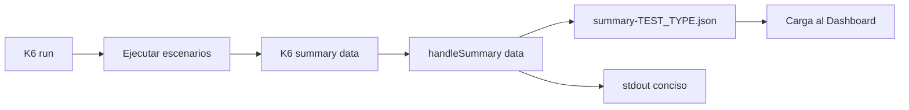
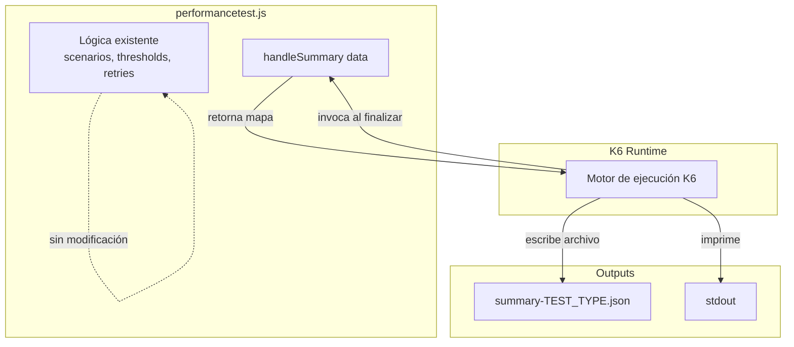
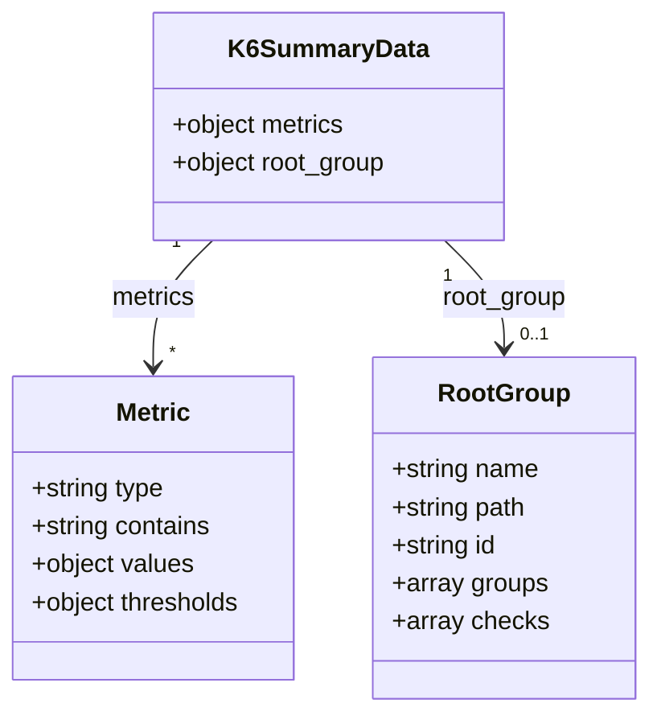
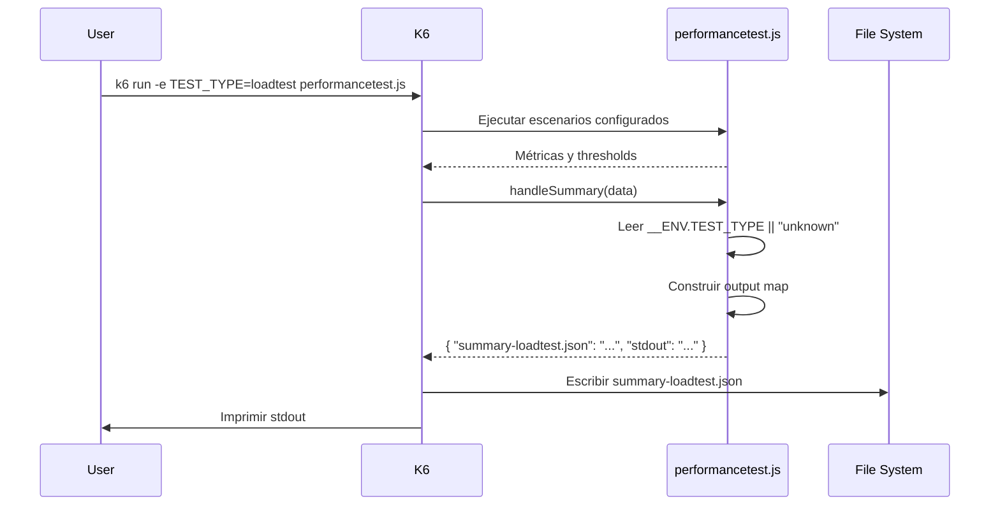

# Design: K6 Summary Export

## Overview

Agregar `handleSummary(data)` al archivo `performancetest.js`. K6 invoca esta función al finalizar la ejecución y escribe los outputs retornados. La implementación debe preservar el objeto de resumen completo de K6 en un archivo JSON, nombrado según el perfil `TEST_TYPE` activo.



## Architecture

La arquitectura es mínima y aditiva. Se agrega una única función exportada (`handleSummary`) al script existente `performancetest.js`. No se introducen archivos, módulos, ni dependencias nuevas.



### Decisiones arquitectónicas

| Decisión | Justificación |
|----------|---------------|
| Función en el mismo archivo | K6 requiere que `handleSummary` se exporte desde el script principal de ejecución. No admite imports de otros archivos para esta función. |
| Sin dependencias adicionales | `JSON.stringify` es nativo del runtime de K6 (basado en ES modules). No se necesitan librerías externas. |
| Uso de `__ENV.TEST_TYPE` | Reutiliza la misma variable de entorno que ya controla la selección de escenarios, manteniendo consistencia. |
| Fallback a "unknown" | Protege contra el caso (improbable) donde `TEST_TYPE` no esté disponible durante la fase de resumen, sin interrumpir la generación del archivo. |

## Components and Interfaces

### Componente: `handleSummary(data)`

**Tipo:** Función exportada (ES module export)

**Responsabilidad:** Transformar el objeto de resumen de K6 en un mapa de salidas (archivos y stdout).

**Interfaz:**

```typescript
// Signatura conceptual (K6 usa ES modules, no TypeScript)
export function handleSummary(data: K6SummaryData): OutputMap;

interface OutputMap {
  [filename: string]: string;  // contenido del archivo
  stdout: string;              // output a terminal
}
```

**Contrato de entrada:**
- `data`: Objeto proporcionado por K6 al finalizar la ejecución. Contiene `metrics`, `root_group`, y metadatos internos.

**Contrato de salida:**
- El objeto retornado DEBE contener exactamente:
  1. Una clave con formato `summary-{testType}.json` → contenido JSON completo
  2. Una clave `stdout` → resumen conciso para terminal

### Componente existente: Validación de `TEST_TYPE`

El script ya valida `TEST_TYPE` al inicio de la ejecución (líneas 17–20 de `performancetest.js`). Esta validación permanece sin cambios. `handleSummary` opera independientemente con un fallback propio.

## Data Models

### Modelo de entrada: K6 Summary Data



### Modelo de salida: Output Map

| Clave | Tipo | Descripción |
|-------|------|-------------|
| `summary-{testType}.json` | `string` | JSON completo del objeto `data`, indentado con 2 espacios |
| `stdout` | `string` | JSON conciso con `test_type` y lista de nombres de métricas |

### Formato del archivo JSON de resumen

```json
{
  "metrics": {
    "http_req_duration": {
      "type": "trend",
      "contains": "time",
      "values": { "avg": 123.45, "p(95)": 200.0 },
      "thresholds": { "p(95) < 2000": { "ok": true } }
    }
  },
  "root_group": {
    "name": "",
    "path": "",
    "id": "",
    "groups": [],
    "checks": []
  }
}
```

### Formato del stdout

```json
{
  "test_type": "loadtest",
  "metrics": ["http_req_duration", "http_req_failed", "waiting_time"]
}
```

## Runtime Sequence



## Output Map (Implementación)

```js
export function handleSummary(data) {
  const testType = __ENV.TEST_TYPE || "unknown";

  return {
    [`summary-${testType}.json`]: JSON.stringify(data, null, 2),
    stdout: JSON.stringify(
      {
        test_type: testType,
        metrics: Object.keys(data.metrics || {})
      },
      null,
      2
    )
  };
}
```

## Correctness Properties

*Una propiedad es una característica o comportamiento que debe mantenerse verdadero en todas las ejecuciones válidas de un sistema — esencialmente, una declaración formal sobre lo que el sistema debe hacer. Las propiedades sirven como puente entre especificaciones legibles por humanos y garantías de corrección verificables por máquina.*

### Property 1: Round-trip de serialización del resumen

*For any* objeto `data` válido de K6, al invocar `handleSummary(data)` y parsear el contenido JSON del archivo de salida, el resultado DEBE ser deep-equal al objeto `data` original.

**Validates: Requirements 1.3, 1.4, 4.1, 4.2, 4.3, 4.4**

### Property 2: Estructura del output map

*For any* objeto `data` y cualquier valor de `TEST_TYPE`, el mapa retornado por `handleSummary(data)` DEBE contener exactamente dos claves: una con formato `summary-{testType}.json` y otra con valor `stdout`.

**Validates: Requirements 1.2, 5.1**

### Property 3: Nombrado de archivo sigue el patrón TEST_TYPE

*For any* valor de `TEST_TYPE` (incluyendo ausencia), la clave del archivo en el output map DEBE ser igual a `summary-{TEST_TYPE}.json` cuando `TEST_TYPE` está definido, o `summary-unknown.json` cuando no lo está.

**Validates: Requirements 2.1, 2.2, 2.3, 2.4, 2.5**

### Property 4: Stdout contiene metadatos del resumen

*For any* objeto `data` con un campo `metrics`, el contenido de `stdout` parseado como JSON DEBE contener las claves `test_type` (string) y `metrics` (array de strings con los nombres de las métricas presentes en `data.metrics`).

**Validates: Requirements 5.2**

## Error Handling

### Escenarios de error y mitigación

| Escenario | Comportamiento esperado | Justificación |
|-----------|------------------------|---------------|
| `TEST_TYPE` no disponible en fase de resumen | Usar `"unknown"` como fallback en el nombre del archivo | La validación principal ocurre al inicio del script (throw). Si por algún edge case del runtime `TEST_TYPE` no está disponible en `handleSummary`, el archivo se genera con nombre genérico en lugar de fallar. |
| `data` es `null` o `undefined` | `JSON.stringify(null)` produce `"null"` — archivo se genera con contenido mínimo | K6 siempre proporciona `data`, pero ante un comportamiento inesperado del runtime, la función no lanza excepciones. |
| `data.metrics` es `undefined` | El fallback `data.metrics || {}` produce un array vacío de claves en stdout | Protege contra versiones de K6 que podrían variar la estructura. |
| Error de escritura en disco (permisos, espacio) | K6 reporta el error — fuera del control de `handleSummary` | La función solo retorna el mapa; K6 maneja la escritura y reporta errores de I/O. |

### Principios de diseño de errores

1. **No lanzar excepciones**: `handleSummary` debe retornar siempre un mapa válido. Un error aquí impediría cualquier output.
2. **Fallbacks defensivos**: Usar operador `||` para valores por defecto.
3. **Delegar I/O a K6**: La función es pura respecto al filesystem — retorna datos, no escribe.

## Compatibility

La exportación es aditiva. No modifica la carga de configuración, creación de escenarios, reintentos, ejecución de requests, checks, sleeps, métricas custom, ni definiciones de thresholds.

El código existente en `performancetest.js` permanece intacto. Solo se agrega la función `handleSummary` al final del archivo como un nuevo export.

## Testing Strategy

### Enfoque dual de pruebas

#### Property-based tests (fast-check)

Se utilizará **fast-check** como librería de property-based testing para JavaScript.

Cada property test debe:
- Ejecutar mínimo **100 iteraciones**
- Referenciar la propiedad del documento de diseño
- Tag format: `Feature: k6-summary-export, Property {number}: {texto}`

| Property | Generador | Verificación |
|----------|-----------|--------------|
| 1: Round-trip serialización | Objetos JSON arbitrarios con estructura `{ metrics: {...}, root_group: {...} }` | `JSON.parse(output[filename])` deep-equals `data` |
| 2: Estructura del output map | Cualquier `data` + cualquier string `testType` | El mapa tiene exactamente 2 claves: `summary-{t}.json` y `stdout` |
| 3: Nombrado de archivo | Strings arbitrarios para `TEST_TYPE`, incluyendo `undefined` | Clave del archivo coincide con patrón esperado |
| 4: Stdout con metadatos | Objetos con `metrics` variado (0 a N métricas) | `stdout` parseado contiene `test_type` y `metrics` correctos |

#### Unit tests (ejemplo-based)

| Caso | Descripción |
|------|-------------|
| Filename para cada TEST_TYPE conocido | Verificar `summary-loadtest.json`, `summary-stresstest.json`, etc. |
| Fallback a unknown | `TEST_TYPE` ausente → `summary-unknown.json` |
| Stdout es más conciso que el archivo completo | `stdout.length < fileContent.length` para datos no triviales |
| La función es exportada | Verificar que `handleSummary` es un export del módulo |

#### Integration tests

| Caso | Descripción |
|------|-------------|
| Aislamiento de comportamiento existente | Verificar que agregar `handleSummary` no altera scenarios, thresholds, retries, ni validación de `TEST_TYPE` |
| Ejecución K6 end-to-end | Ejecutar `k6 run` con la función agregada y verificar que el archivo JSON se genera correctamente |

### Configuración de property tests

```js
import fc from "fast-check";

// Mínimo 100 iteraciones por propiedad
const settings = { numRuns: 100 };
```

### Nota sobre el entorno de testing

K6 usa un runtime propio (goja/ES modules). Para unit tests y property tests, se debe extraer la lógica de `handleSummary` de forma que pueda ejecutarse en Node.js con un mock de `__ENV`. Los integration tests se ejecutan con el CLI de K6 real.
