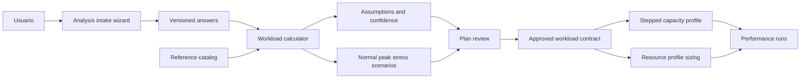

# Diseño De Performance Analysis Intake

## Overview

La solución agrega un wizard de intake que recopila contexto de negocio, demanda, comportamiento, calidad esperada y objetivos de prueba. Con esas respuestas construye un `workload model`, muestra supuestos y genera un `workload contract` versionado para las pruebas posteriores.

El wizard no ejecuta benchmarks ni recomienda hardware por sí solo. Su responsabilidad es producir una hipótesis de carga revisable y suficientemente trazable para `stepped-capacity-discovery` y `resource-profile-sizing`.

## Architecture



El proceso tiene dos estados principales: borrador y aprobado. Un contrato aprobado es inmutable; cualquier cambio crea una nueva versión y evita comparar silenciosamente resultados de versiones distintas.

## Components and Interfaces

### Analysis intake wizard

Secciones mínimas:

1. Contexto de la aplicación.
2. Demanda actual y proyectada.
3. Usuarios y sesiones.
4. Business journeys.
5. Integraciones y operaciones batch.
6. SLO y objetivos de prueba.
7. Supuestos, referencias y revisión.

El wizard debe mostrar progreso, campos obligatorios, datos faltantes y el impacto de cada respuesta sobre el workload model.

### Answer store

- Guarda respuestas con versión.
- Conserva la fuente del valor: `user`, `derived`, `reference` o `default`.
- No guarda secretos ni credenciales.
- Permite reanudar borradores.
- Congela la versión al aprobar el plan.

### Workload calculator

Calcula tasas y escenarios con fórmulas determinísticas. Cada resultado conserva entradas, fórmula, salida, unidad y confianza.

### Reference catalog

Es un catálogo curado y versionado de fuentes externas. La primera versión acepta carga manual de referencias. La consulta web en tiempo de ejecución no es necesaria para generar un plan.

### Plan reviewer

- Muestra escenarios y targets.
- Muestra supuestos y datos faltantes.
- Permite aprobar, devolver para corrección o crear una versión nueva.
- No permite ejecutar un contrato sin aprobación.

### Workload contract exporter

Exporta un contrato consumible por los perfiles existentes sin incluir detalles privados del adapter. El contrato debe contener la versión del análisis y su digest.

## Data Models

### Analysis input

```json
{
  "analysis_id": "analysis-001",
  "version": 1,
  "status": "draft",
  "application_type": "ecommerce",
  "test_objectives": ["capacity", "stress", "growth"],
  "horizon": {
    "current": 1000,
    "six_months": 10000,
    "twelve_months": 25000,
    "unit": "registered_customers"
  },
  "answers": [],
  "references": [],
  "created_at": "2026-11-04T00:00:00Z"
}
```

### Business journey

```json
{
  "id": "checkout",
  "name": "Checkout",
  "priority": "critical",
  "share_of_users_percent": 15,
  "frequency_per_user_per_day": 1,
  "average_duration_seconds": 120,
  "operations": [
    {
      "name": "create_order",
      "count": 1,
      "type": "write"
    },
    {
      "name": "payment_status",
      "count": 2,
      "type": "read"
    }
  ],
  "slo": {
    "latency_p95_ms": 800,
    "error_rate_percent": 1
  }
}
```

### Derived metric

```json
{
  "metric": "arrival_rate",
  "value": 8.33,
  "unit": "iterations_per_second",
  "source": "derived",
  "formula": "daily_sessions * peak_share / peak_window_seconds",
  "inputs": ["daily_active_users", "sessions_per_user_per_day", "peak_share"],
  "confidence": "medium"
}
```

### Workload contract

```json
{
  "analysis_id": "analysis-001",
  "analysis_version": 1,
  "contract_digest": "sha256:...",
  "status": "approved",
  "scenarios": [
    {
      "id": "peak",
      "type": "capacity",
      "target_rate": 20,
      "unit": "iterations_per_second",
      "duration": "4m",
      "peak_multiplier": 2,
      "confidence": "medium"
    }
  ],
  "slo": {
    "latency_p95_ms": 500,
    "error_rate_percent": 1
  },
  "assumptions": [],
  "missing_data": []
}
```

## Workload Calculations

### Active users

Cuando se cuenta con clientes registrados y porcentaje activo:

```text
daily_active_users = registered_users * active_user_percent / 100
```

Si no existe porcentaje activo, el valor queda no disponible.

### Daily sessions

```text
daily_sessions = daily_active_users * sessions_per_user_per_day
```

### Peak arrival rate

```text
peak_sessions = daily_sessions * peak_share_percent / 100
arrival_rate = peak_sessions / peak_window_seconds
```

La encuesta debe solicitar la duración de la ventana pico. No se debe asumir que todo el tráfico diario ocurre en una hora.

### Request rate

```text
requests_per_journey = sum(operation.count)
request_rate = arrival_rate * requests_per_journey
```

El cálculo debe conservar lecturas y escrituras separadas cuando el journey las declare.

### Concurrency

```text
concurrency = arrival_rate * average_journey_duration_seconds
```

La concurrencia es estimada y no sustituye una medición real de conexiones o VUs.

### Scenarios

- `normal`: demanda esperada sin multiplicador adicional.
- `peak`: demanda de la ventana pico.
- `stress`: demanda pico multiplicada por un factor explícito.
- `soak`: demanda estable durante una duración prolongada, si el usuario la solicita.

Cada escenario debe declarar su origen, fórmula, duración, target y confianza.

## Confidence Rules

- **Alta**: valor medido por analítica o histórico confiable, workload completo y SLO definidos.
- **Media**: mezcla de datos proporcionados y supuestos documentados.
- **Baja**: múltiples valores derivados, referencias genéricas o datos faltantes relevantes.

La confianza del contrato debe ser igual o inferior a la confianza de su dato crítico de menor calidad.

## API Contracts

La interfaz de aplicación debe soportar como mínimo:

```text
POST   /analyses
GET    /analyses/{analysisId}
PUT    /analyses/{analysisId}/answers
POST   /analyses/{analysisId}/calculate
GET    /analyses/{analysisId}/plan
POST   /analyses/{analysisId}/approve
POST   /analyses/{analysisId}/clone
GET    /analyses/{analysisId}/workload-contract
```

La ruta final depende de la aplicación que integre el framework. El contrato lógico debe conservar los mismos estados, versionado y trazabilidad.

## Integration Contracts

### `stepped-capacity-discovery`

El workload contract debe mapear escenarios aprobados a:

- Targets de arrival rate.
- Warm-up.
- Transiciones.
- Measurement windows.
- Duración por etapa.
- Thresholds y SLO.

### `resource-profile-sizing`

El sizing debe recibir:

- Analysis ID.
- Contract digest.
- Escenario seleccionado.
- Target rate.
- SLO.
- Headroom separado del modelo de negocio.
- Assumptions y confidence.

## Error Handling

- Respuestas incompletas: el borrador se conserva y el plan queda bloqueado.
- Unidades incompatibles: se solicita corrección antes de calcular.
- Valores negativos o porcentajes fuera de rango: error de validación.
- Contradicciones entre respuestas: se marca el conflicto y se reduce la confianza.
- Falta de SLO: el escenario puede generarse como propuesta, pero no como plan validado.
- Cambio posterior a aprobación: se crea una nueva versión.

## Testing Strategy

- Pruebas de validación por sección y por unidad.
- Pruebas de fórmulas con casos conocidos.
- Pruebas de unidades, porcentajes, ventanas pico y duraciones inválidas.
- Pruebas de versionado y aprobación.
- Pruebas de contratos para `workload contract`.
- Pruebas de integración con `capacity-stepped`.
- Pruebas de integración con `resource-profile-sizing`.
- Pruebas de privacidad para impedir secretos y datos sensibles.
- Pruebas de regresión para no modificar contratos aprobados.

## Decisiones Técnicas

- La encuesta genera hipótesis de carga y no sustituye benchmarks reales.
- Las fórmulas son determinísticas y visibles para que el usuario pueda revisarlas.
- Las referencias externas se versionan como evidencia, pero no se consultan obligatoriamente durante una ejecución.
- La aprobación explícita separa la captura de requisitos de la ejecución operativa.
- El headroom y la política de repeticiones permanecen en sizing y QA; el intake solo captura el contexto que puede influir en ellos.
- El contrato de workload se versiona para impedir comparaciones entre modelos diferentes.

## Riesgos e Incertidumbres

- Los usuarios pueden confundir clientes registrados con usuarios activos.
- Un journey mal descrito puede producir un request rate incorrecto.
- Las referencias generales pueden no representar el dominio concreto.
- La duración de sesión no necesariamente representa duración de requests.
- Un peak multiplier arbitrario puede sobredimensionar o subdimensionar la prueba.
- Los datos de negocio pueden ser confidenciales y requieren política de retención.

## Correctness Properties

1. Un valor derivado siempre referencia sus entradas y fórmula.
2. Un workload contract aprobado siempre referencia una versión de análisis inmutable.
3. Un plan no aprobado nunca se ejecuta como benchmark oficial.
4. La concurrencia estimada usa arrival rate y duración del journey de la misma versión.
5. Un cambio en respuestas aprobadas crea un nuevo digest de contrato.
6. Un dato faltante nunca se convierte silenciosamente en cero.
7. Un scenario no puede tener un target negativo, una duración inválida o una unidad ausente.
