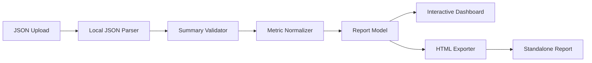
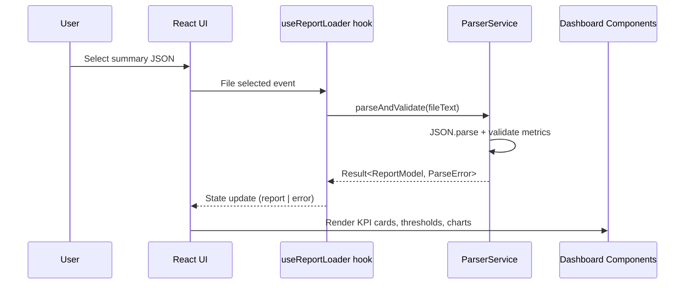
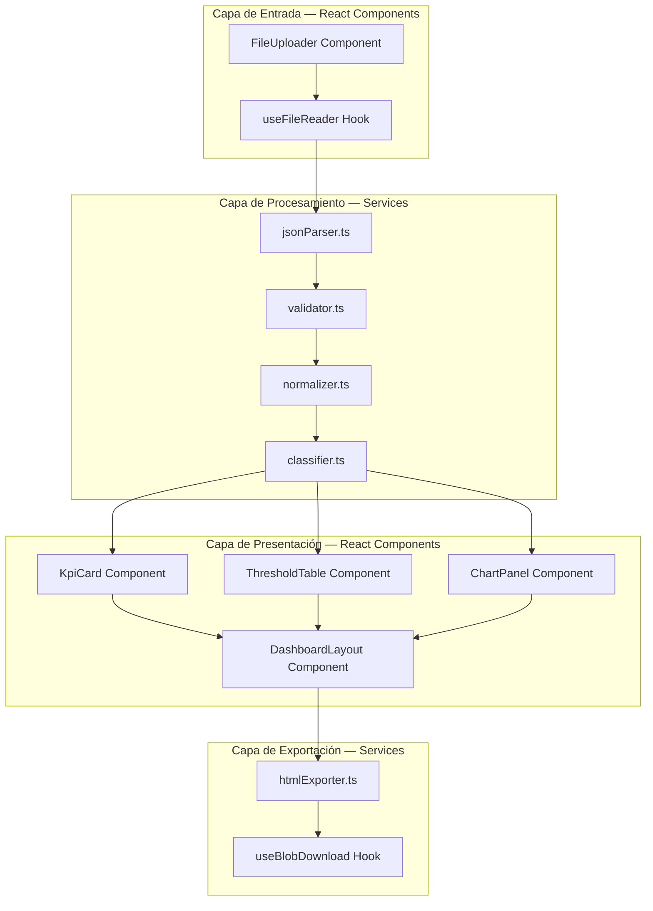
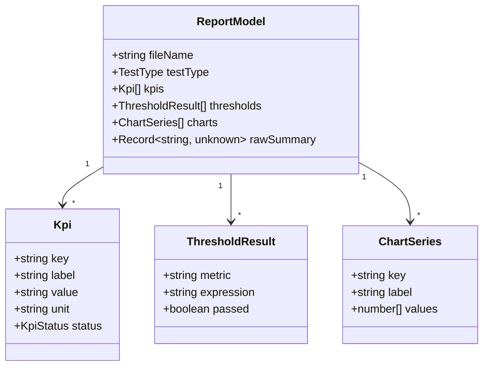
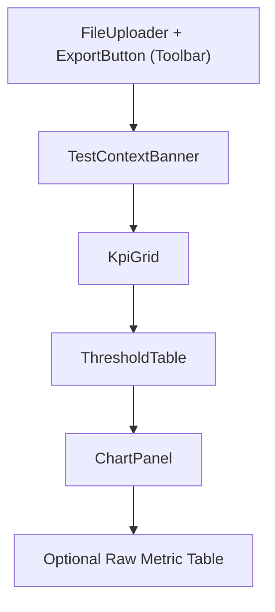
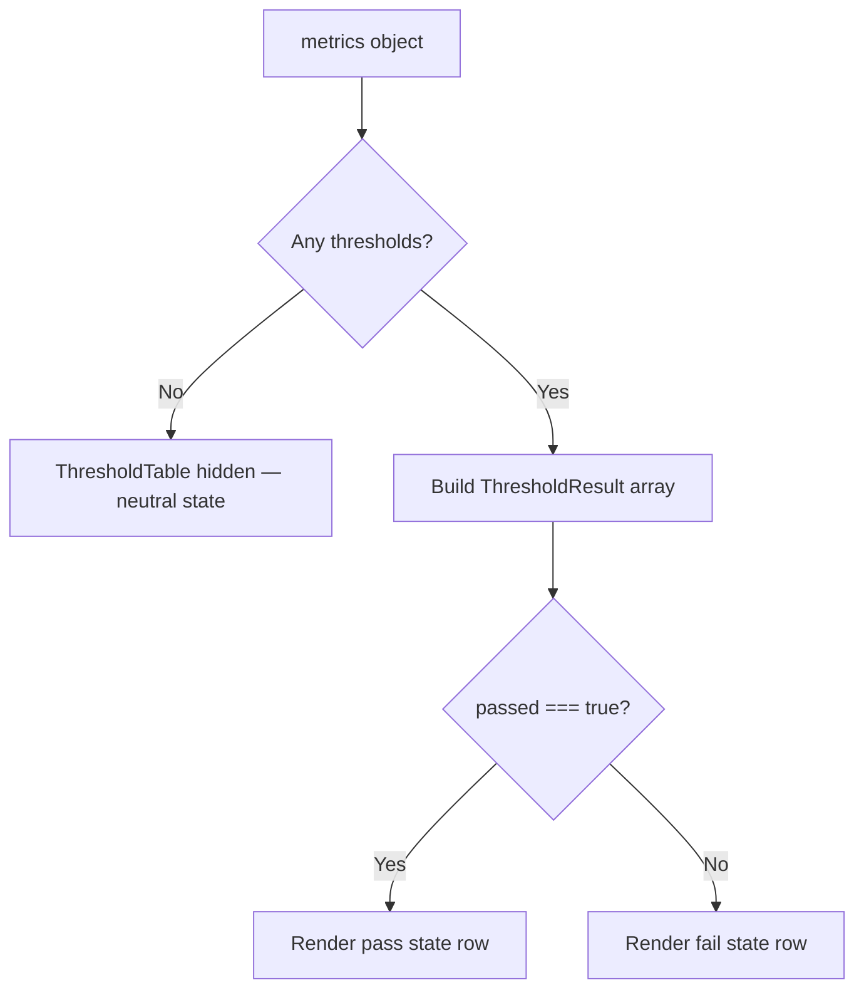

# Design: Performance Dashboard

## Overview

El dashboard es una aplicación React + TypeScript servida por Vite que importa archivos JSON de resumen de K6, valida la estructura, normaliza métricas, renderiza tarjetas KPI y gráficos, y exporta reportes HTML autónomos. No requiere backend ni dependencias externas en tiempo de ejecución — todo el procesamiento ocurre localmente en el navegador.



### Flujo de importación



## Architecture

La aplicación sigue una arquitectura de pipeline unidireccional implementada con React + TypeScript + Vite, sin backend ni servicios externos.

### Stack tecnológico

| Componente | Tecnología |
| --- | --- |
| Framework | React 18+ con TypeScript |
| Build tool | Vite |
| Test runner | Vitest |
| PBT library | fast-check |
| State management | React state + Context API |
| Styling | CSS Modules |
| Charts | Canvas/SVG inline (sin librería externa en v1) |

### Capas

1. **Capa de entrada (Input Layer)**: Componente React `FileUploader` que encapsula `<input type="file">` y `FileReader` API.
2. **Capa de procesamiento (Processing Layer)**: Servicios TypeScript puros para parsing JSON, validación de estructura y normalización de métricas.
3. **Capa de presentación (Rendering Layer)**: Componentes React (`KpiCard`, `ThresholdTable`, `ChartPanel`) que renderizan el estado del `ReportModel`.
4. **Capa de exportación (Export Layer)**: Servicio de generación de HTML autónomo con datos embebidos.

### Diagrama de capas



### Decisiones arquitectónicas

| Decisión | Justificación |
| --- | --- |
| React 18+ con TypeScript | Type safety en compilación, componentes declarativos, ecosistema maduro. Compatible con roadmap v2 (NestJS). |
| Vite como build tool | HMR rápido, configuración mínima, integración nativa con TypeScript y Vitest. |
| Servicios puros separados de componentes | La lógica de parsing/validación/normalización es testeable de forma aislada sin React. |
| Gráficos con Canvas/SVG inline | Evita dependencia de librerías de charting en primera versión. Fácil migrar a librería si se justifica en v2. |
| React Context para estado global | El estado del dashboard es simple (un `ReportModel` activo). No justifica Redux/Zustand en v1. |
| CSS Modules | Scoping automático sin runtime overhead. Compatible con Vite out-of-the-box. |
| Datos embebidos en export HTML | El HTML exportado es autónomo sin necesidad del JSON original. |

## Components and Interfaces

### Estructura de archivos del código fuente

```text
src/
├── main.tsx                         ← Entry point React + ReactDOM
├── App.tsx                          ← Componente raíz, provee ReportContext
├── components/
│   ├── FileUploader.tsx             ← Control de carga de archivo
│   ├── KpiCard.tsx                  ← Tarjeta individual de KPI
│   ├── KpiGrid.tsx                  ← Grid de tarjetas KPI
│   ├── ThresholdTable.tsx           ← Tabla de resultados de thresholds
│   ├── ChartPanel.tsx               ← Panel de gráficos
│   ├── DashboardLayout.tsx          ← Layout general del dashboard
│   ├── TestContextBanner.tsx        ← Banner de contexto de prueba
│   └── ExportButton.tsx             ← Botón de exportación HTML
├── hooks/
│   ├── useFileReader.ts             ← Hook para lectura local de archivos
│   ├── useReportLoader.ts           ← Hook orquestador: parse → validate → normalize
│   └── useBlobDownload.ts           ← Hook para descarga de blob
├── models/
│   ├── report.ts                    ← Interfaces: ReportModel, Kpi, ThresholdResult, ChartSeries
│   ├── errors.ts                    ← Tipos de error: ParseError, Result<T,E>
│   └── metrics.ts                   ← Constantes de mapeo de métricas
├── services/
│   ├── parseAndValidate.ts          ← Parsing + validación de estructura
│   ├── normalize.ts                 ← Normalización de métricas → ReportModel
│   ├── extractKpis.ts              ← Extracción de KPIs con fallback
│   ├── extractThresholds.ts         ← Extracción de thresholds
│   ├── classifyTestType.ts          ← Clasificación por nombre de archivo
│   ├── buildCharts.ts              ← Construcción de series de gráficos
│   └── exportHtml.ts               ← Generación de HTML autónomo
├── context/
│   └── ReportContext.tsx            ← Context + Provider para ReportModel
├── assets/
│   └── styles/
│       └── dashboard.module.css     ← Estilos principales
└── index.html                       ← HTML host (Vite)
```

### Interfaces TypeScript principales

#### Tipos de resultado y error

```typescript
// src/models/errors.ts

export type ParseErrorType = "INVALID_JSON" | "MISSING_METRICS";

export interface ParseError {
  type: ParseErrorType;
  message: string;
}

export type Result<T, E> = 
  | { ok: true; data: T }
  | { ok: false; error: E };
```

#### Servicios

##### `parseAndValidate(fileText: string): Result<RawSummary, ParseError>`

Parsea el texto del archivo y valida que contenga un objeto `metrics`.

```typescript
// src/services/parseAndValidate.ts
import { Result, ParseError } from "../models/errors";
import { RawSummary } from "../models/metrics";

export function parseAndValidate(fileText: string): Result<RawSummary, ParseError>;
```

##### `normalize(raw: RawSummary, fileName: string): ReportModel`

Transforma el JSON crudo en un modelo normalizado con KPIs, thresholds y series de gráficos.

```typescript
// src/services/normalize.ts
import { RawSummary } from "../models/metrics";
import { ReportModel } from "../models/report";

export function normalize(raw: RawSummary, fileName: string): ReportModel;
```

##### `classifyTestType(fileName: string): TestType`

Determina el tipo de prueba basándose en el nombre del archivo.

```typescript
// src/services/classifyTestType.ts

export type TestType = "loadtest" | "stresstest" | "capacitytest" | "stabilitytest" | "unknown";

export function classifyTestType(fileName: string): TestType;
```

##### `extractKpis(metrics: Record<string, unknown>): Kpi[]`

Extrae los KPIs del objeto de métricas usando la tabla de mapeo. Retorna `"N/A"` para métricas ausentes.

```typescript
// src/services/extractKpis.ts
import { Kpi } from "../models/report";

export function extractKpis(metrics: Record<string, unknown>): Kpi[];
```

##### `extractThresholds(metrics: Record<string, unknown>): ThresholdResult[]`

Extrae los resultados de thresholds de las métricas. Retorna array vacío si no hay thresholds.

```typescript
// src/services/extractThresholds.ts
import { ThresholdResult } from "../models/report";

export function extractThresholds(metrics: Record<string, unknown>): ThresholdResult[];
```

##### `buildCharts(metrics: Record<string, unknown>): ChartSeries[]`

Construye las series de datos para gráficos a partir de las métricas normalizadas.

```typescript
// src/services/buildCharts.ts
import { ChartSeries } from "../models/report";

export function buildCharts(metrics: Record<string, unknown>): ChartSeries[];
```

##### `exportHtml(model: ReportModel): string`

Genera un string HTML autónomo con estilos, datos embebidos y código de renderizado inline.

```typescript
// src/services/exportHtml.ts
import { ReportModel } from "../models/report";

export function exportHtml(model: ReportModel): string;
```

### Componentes React principales

#### `<FileUploader />`

Componente controlado que encapsula un `<input type="file" accept=".json">` y dispara la carga vía `useFileReader`.

```typescript
interface FileUploaderProps {
  onFileLoaded: (text: string, fileName: string) => void;
  disabled?: boolean;
}
```

#### `<KpiCard />`

Tarjeta individual que muestra un KPI con estado visual.

```typescript
interface KpiCardProps {
  label: string;
  value: string;
  unit: string;
  status: "normal" | "warning" | "critical";
}
```

#### `<KpiGrid />`

Grid responsivo que renderiza la lista de `Kpi[]` como tarjetas.

```typescript
interface KpiGridProps {
  kpis: Kpi[];
}
```

#### `<ThresholdTable />`

Tabla con filas pass/fail para cada threshold.

```typescript
interface ThresholdTableProps {
  thresholds: ThresholdResult[];
}
```

#### `<ChartPanel />`

Panel que renderiza gráficos Canvas/SVG para las series de métricas.

```typescript
interface ChartPanelProps {
  charts: ChartSeries[];
}
```

#### `<DashboardLayout />`

Layout principal que organiza los componentes en el orden definido.

```typescript
interface DashboardLayoutProps {
  report: ReportModel;
  onExport: () => void;
}
```

#### `<ExportButton />`

Botón que dispara la generación y descarga del HTML.

```typescript
interface ExportButtonProps {
  disabled: boolean;
  onExport: () => void;
}
```

### Hooks personalizados

#### `useFileReader()`

```typescript
function useFileReader(): {
  readFile: (file: File) => Promise<string>;
  isReading: boolean;
  error: string | null;
};
```

#### `useReportLoader()`

Hook orquestador que combina parsing, validación y normalización.

```typescript
function useReportLoader(): {
  report: ReportModel | null;
  error: ParseError | null;
  loadFile: (text: string, fileName: string) => void;
  reset: () => void;
};
```

#### `useBlobDownload()`

```typescript
function useBlobDownload(): {
  download: (content: string, fileName: string, mimeType: string) => void;
};
```

### Tabla de mapeo de métricas

| Dashboard Field | Preferred Metric | Fallback |
| --- | --- | --- |
| Total requests | `http_reqs.values.count` | `Total_Reqs.values.count` |
| Failed request rate | `http_req_failed.values.rate` | `N/A` |
| Avg duration | `http_req_duration.values.avg` | `N/A` |
| P95 duration | `http_req_duration.values["p(95)"]` | `N/A` |
| P99 duration | `http_req_duration.values["p(99)"]` | `N/A` |
| Avg waiting time | `http_req_waiting.values.avg` | `waiting_time.values.avg` |
| Iterations | `iterations.values.count` | `N/A` |
| Checks | `checks.values.rate` | `N/A` |
| Retries | `retries.values.count` | `N/A` |

## Data Models

### Interfaces TypeScript

```typescript
// src/models/report.ts

export interface ReportModel {
  fileName: string;
  testType: TestType;
  kpis: Kpi[];
  thresholds: ThresholdResult[];
  charts: ChartSeries[];
  rawSummary: Record<string, unknown>;
}

export interface Kpi {
  key: string;
  label: string;
  value: string;
  unit: string;
  status: KpiStatus;
}

export type KpiStatus = "normal" | "warning" | "critical";

export interface ThresholdResult {
  metric: string;
  expression: string;
  passed: boolean;
}

export interface ChartSeries {
  key: string;
  label: string;
  values: number[];
}

export type TestType = "loadtest" | "stresstest" | "capacitytest" | "stabilitytest" | "unknown";
```

### Diagrama de clases (ReportModel)



### Descripción de campos

**ReportModel**
- `fileName`: Nombre original del archivo subido (usado para clasificación de tipo de prueba).
- `testType`: Tipo de prueba inferido (`loadtest`, `stresstest`, `capacitytest`, `stabilitytest`, `unknown`).
- `kpis`: Lista de indicadores clave extraídos.
- `thresholds`: Lista de resultados de thresholds (vacía si no hay datos).
- `charts`: Series de datos para renderizar gráficos.
- `rawSummary`: Objeto JSON original para referencia.

**Kpi**
- `key`: Identificador interno de la métrica (e.g., `http_reqs`).
- `label`: Etiqueta legible para el usuario (e.g., "Total Requests").
- `value`: Valor formateado como string (e.g., `"1,234"`) o `"N/A"` si no disponible.
- `unit`: Unidad de medida (`ms`, `req/s`, `%`, `count`).
- `status`: Estado visual (`normal`, `warning`, `critical`).

**ThresholdResult**
- `metric`: Nombre de la métrica asociada (e.g., `http_req_duration`).
- `expression`: Expresión del threshold (e.g., `p(95)<500`).
- `passed`: Booleano indicando si el threshold fue cumplido.

**ChartSeries**
- `key`: Identificador de la serie.
- `label`: Etiqueta para leyenda del gráfico.
- `values`: Valores numéricos de la serie.

### Layout del dashboard



## Correctness Properties

*Una propiedad es una característica o comportamiento que debe cumplirse en todas las ejecuciones válidas de un sistema — esencialmente, una declaración formal sobre lo que el sistema debe hacer. Las propiedades sirven como puente entre especificaciones legibles por humanos y garantías de correctitud verificables por máquina.*

### Property 1: Rechazo de JSON inválido

*For any* string que no sea JSON válido, `parseAndValidate` SHALL retornar un error de tipo `INVALID_JSON` y nunca producir un modelo válido.

**Validates: Requirements 1.3**

### Property 2: Rechazo de JSON sin métricas

*For any* objeto JSON válido que no contenga una propiedad `metrics`, `parseAndValidate` SHALL retornar un error de tipo `MISSING_METRICS`.

**Validates: Requirements 1.4**

### Property 3: Normalización produce modelo válido

*For any* K6 summary JSON válido (con objeto `metrics`), `normalize` SHALL producir un `ReportModel` con `fileName` no vacío, `testType` definido, y arrays `kpis`, `thresholds`, `charts` inicializados.

**Validates: Requirements 1.5**

### Property 4: Extracción correcta de KPIs

*For any* objeto de métricas K6 y cualquier métrica soportada presente en la tabla de mapeo, `extractKpis` SHALL producir un KPI cuyo `value` corresponda al valor numérico en la ruta esperada del objeto de métricas.

**Validates: Requirements 2.1, 2.2, 2.3, 2.4, 2.5, 2.6, 2.7, 2.8, 2.9**

### Property 5: Degradación elegante para métricas ausentes

*For any* objeto de métricas K6 donde un subconjunto de métricas soportadas esté ausente, `extractKpis` SHALL producir KPIs con valor `"N/A"` para cada métrica faltante, sin lanzar errores.

**Validates: Requirements 2.10**

### Property 6: Estado de threshold corresponde al booleano ok

*For any* threshold presente en las métricas, el `ThresholdResult` generado SHALL tener `passed === true` cuando el threshold original indica `ok: true`, y `passed === false` cuando indica `ok: false`.

**Validates: Requirements 3.2, 3.3**

### Property 7: Preservación del nombre de métrica en thresholds

*For any* threshold con nombre de métrica asociado, el `ThresholdResult` generado SHALL contener ese nombre de métrica en su campo `metric`.

**Validates: Requirements 3.5**

### Property 8: Clasificación de tipo de prueba por nombre de archivo

*For any* nombre de archivo, `classifyTestType` SHALL retornar el tipo correcto si el nombre contiene exactamente uno de los keywords conocidos (`loadtest`, `stresstest`, `capacitytest`, `stabilitytest`), y `"unknown"` si no contiene ninguno.

**Validates: Requirements 5.1, 5.2, 5.3, 5.4, 5.5**

### Property 9: Round-trip de exportación HTML

*For any* `ReportModel` válido, `exportHtml` SHALL producir un string HTML que contenga los datos del modelo embebidos de forma que puedan ser extraídos y reconstituidos sin acceso al JSON original.

**Validates: Requirements 6.2, 6.3**

## Error Handling

### Estrategia general

Todos los errores se manejan localmente en el navegador sin propagación a servicios externos. Los errores se propagan mediante el tipo `Result<T, E>` en la capa de servicios y se reflejan en el estado de React para renderizar feedback al usuario.

### Errores de parsing

| Condición | Comportamiento | UI |
| --- | --- | --- |
| Archivo no es JSON válido | `parseAndValidate` retorna `ParseError` con tipo `INVALID_JSON` | Muestra mensaje de error de parseo al usuario |
| JSON sin objeto `metrics` | `parseAndValidate` retorna `ParseError` con tipo `MISSING_METRICS` | Muestra mensaje de archivo no soportado |

### Errores de métricas

| Condición | Comportamiento | UI |
| --- | --- | --- |
| Métrica individual ausente | `extractKpis` retorna `"N/A"` para esa métrica | `<KpiCard>` muestra "N/A" con estado `normal` |
| Sin datos de thresholds | `extractThresholds` retorna array vacío | `<ThresholdTable>` oculto, estado neutral |
| Valor de métrica con tipo inesperado | Coerción segura a string o `"N/A"` | `<KpiCard>` muestra "N/A" |

### Errores de exportación

| Condición | Comportamiento | UI |
| --- | --- | --- |
| No hay modelo cargado | Exportación deshabilitada vía estado React | `<ExportButton disabled>` renderizado gris |
| Error durante generación HTML | Catch con mensaje al usuario vía estado | Alerta inline con descripción del error |

### Diagrama de flujo de thresholds



## Testing Strategy

### Enfoque dual

La estrategia combina tests unitarios basados en ejemplos con tests basados en propiedades para cobertura completa. El test runner es **Vitest**, integrado nativamente con el ecosistema Vite.

### Tests basados en propiedades (PBT)

**Librería**: [fast-check](https://github.com/dubzzz/fast-check) — PBT nativa para TypeScript, compatible con Vitest.

**Configuración**:
- Mínimo 100 iteraciones por test de propiedad (`{ numRuns: 100 }`).
- Cada test referencia su propiedad del documento de diseño.
- Formato de tag: `Feature: performance-dashboard, Property {N}: {texto}`
- Los property tests se ejecutan con `vitest --run` (no watch mode).

**Propiedades a implementar**:

| Propiedad | Módulo bajo test | Generador |
| --- | --- | --- |
| 1: Rechazo JSON inválido | `parseAndValidate` | `fc.string()` filtrado para no-JSON |
| 2: Rechazo sin métricas | `parseAndValidate` | `fc.record()` sin key `metrics` |
| 3: Normalización válida | `normalize` | Objetos K6 summary válidos generados con `fc.record` |
| 4: Extracción de KPIs | `extractKpis` | Objetos metrics con subconjuntos aleatorios de métricas |
| 5: Degradación elegante | `extractKpis` | Objetos metrics con métricas faltantes |
| 6: Estado de threshold | `extractThresholds` | Métricas con thresholds de estado aleatorio |
| 7: Nombre de métrica en threshold | `extractThresholds` | Métricas con nombres aleatorios |
| 8: Clasificación de tipo | `classifyTestType` | `fc.string()` con/sin keywords |
| 9: Round-trip HTML export | `exportHtml` | `ReportModel` instances generadas con arbitraries compuestos |

### Tests unitarios (ejemplo-based)

| Área | Framework | Casos |
| --- | --- | --- |
| Servicios (parsing, validación) | Vitest | Archivo válido parsea, JSON sin metrics falla |
| Componentes React | Vitest + React Testing Library | `<FileUploader>` renderiza input, `<KpiCard>` muestra valor, `<ExportButton>` disabled sin report |
| Gráficos | Vitest + React Testing Library | `<ChartPanel>` renderiza canvas/SVG, failure indicator se muestra |
| Exportación | Vitest | Botón habilitado con report, HTML generado contiene datos |
| Privacidad | Vitest | Sin requests de red durante import y export |

### Tests de edge cases

- JSON vacío `{}`
- Archivo de 0 bytes
- Métricas con valores `null` o `undefined`
- Nombre de archivo sin extensión
- Nombre de archivo con múltiples keywords (e.g., `loadtest_stresstest.json`)
- Thresholds sin expresión
- Objeto `metrics` vacío (`{ "metrics": {} }`)

### Estructura de archivos de test

```text
tests/
├── unit/
│   ├── parseAndValidate.test.ts
│   ├── normalize.test.ts
│   ├── extractKpis.test.ts
│   ├── extractThresholds.test.ts
│   ├── classifyTestType.test.ts
│   ├── exportHtml.test.ts
│   └── components/
│       ├── FileUploader.test.tsx
│       ├── KpiCard.test.tsx
│       ├── ThresholdTable.test.tsx
│       ├── ChartPanel.test.tsx
│       └── ExportButton.test.tsx
├── properties/
│   ├── parse.property.test.ts
│   ├── kpi.property.test.ts
│   ├── threshold.property.test.ts
│   ├── classify.property.test.ts
│   └── export.property.test.ts
└── integration/
    └── pipeline.integration.test.ts
```

### Configuración de Vitest

```typescript
// vitest.config.ts (referencia)
import { defineConfig } from "vitest/config";

export default defineConfig({
  test: {
    globals: true,
    environment: "jsdom",
    include: ["tests/**/*.test.{ts,tsx}"],
    coverage: {
      provider: "v8",
      include: ["src/services/**", "src/components/**", "src/hooks/**"],
    },
  },
});
```
