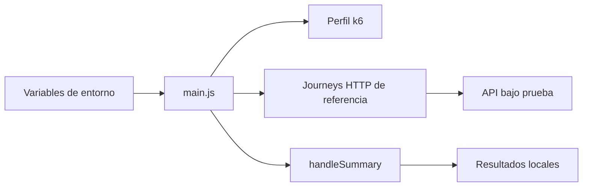

# Diseño Del Adapter De Referencia Para APIs

## Overview

El adapter se implementa como un proyecto k6 bajo `k6/projects/reference`. Usa modulos compartidos de configuracion, perfiles, metricas y utilidades de entorno. Los journeys permanecen separados para facilitar su mantenimiento.

## Architecture

## Components And Interfaces

- `main.js`: carga configuracion, construye el escenario, selecciona journeys y exporta resultados.
- `config/defaults.js`: valores predeterminados del proyecto.
- `data/default.js`: dataset generico sin secretos.
- `journeys/*.js`: flujos funcionales independientes.
- `core/config/env.js`: lectura tipada de variables de entorno.
- `core/metrics/journey.js`: metricas y tags comunes.

## Data Models

- `enabledJourneys`: lista de nombres de journey.
- `weights`: mapa de pesos numericos.
- `dataset`: identificadores y payloads genericos del escenario.
- `runConfig`: identificador, proyecto, perfil, URL saneada, journeys y thresholds.

## Error Handling

- Un journey desconocido produce error de ejecucion.
- Una lista de journeys vacia produce error antes de iniciar trafico.
- La URL incluida en `run-config.json` elimina credenciales embebidas.

## Testing Strategy

- Pruebas unitarias para lectura de variables y seleccion de journeys.
- Pruebas de integracion con API simulada para journeys.
- Verificacion de que escritura y transaccion permanezcan deshabilitadas por defecto.

## Decisiones Tecnicas

- Se mantiene un adapter de referencia para reutilizar el core k6 sin acoplarlo a un sistema privado.
- Las operaciones mutables permanecen opt-in y usan datos de ejemplo controlados.
