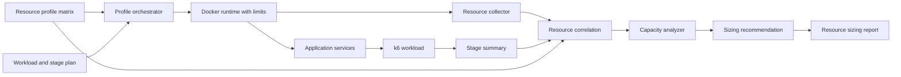

# Diseño De Resource Profile Sizing

## Overview

La solución agrega una capa de sizing sobre la capacidad escalonada existente. El framework ejecuta el mismo workload con diferentes perfiles de recursos genéricos, correlaciona la carga con los recursos asignados y observados, y genera recomendaciones basadas únicamente en resultados válidos y comparables.

La salida no representa un proveedor de infraestructura. Representa una capacidad medida de la aplicación y una distribución de recursos que puede traducirse posteriormente a cualquier entorno de despliegue.

## Architecture



El flujo mantiene separado el descubrimiento de carga del sizing. `capacity-stepped` define la curva de carga; `resource-profile-sizing` repite esa curva bajo perfiles de recursos y compara los resultados.

## Components and Interfaces

### Resource profile catalog

Mantiene perfiles declarativos con:

- Identificador estable.
- CPU total disponible.
- Memoria total disponible.
- Almacenamiento declarado, cuando aplique.
- Asignación de CPU y memoria por servicio.
- Límites operativos aplicables.
- Orden de comparación.

Los perfiles deben ser agnósticos de proveedor. `small`, `medium` y `large` son nombres de comparación, no tamaños universales.

### Profile orchestrator

- Valida la matriz antes de iniciar.
- Prepara el runtime con los límites del perfil.
- Ejecuta el mismo adapter, workload y stage plan.
- Registra el perfil exacto en `run-config.json`.
- Aísla los resultados por `run-id`.
- No inicia el siguiente perfil si falla un precheck global crítico.

### Docker resource adapter

El adapter de runtime traduce el perfil a límites del motor de contenedores. La traducción debe mantener separadas las siguientes capacidades:

- CPU asignada y CPU máxima.
- Memoria asignada y comportamiento ante excedente.
- Almacenamiento declarado y almacenamiento medible.
- Servicios que reciben cada asignación.

Cuando el runtime no pueda aplicar o medir un recurso, debe reportarlo como no disponible. No debe simular que el límite fue aplicado.

### Capacity analyzer

- Descarta ejecuciones inválidas o no comparables.
- Utiliza solamente measurement windows.
- Calcula capacidad segura por perfil.
- Identifica presión por recurso.
- Conserva métricas medidas y derivadas por separado.
- Ordena perfiles por capacidad segura y consumo de recursos.

### Sizing recommender

Recibe:

- Carga objetivo.
- Headroom requerido.
- SLO de latencia y errores.
- Perfiles comparables.
- Capacidad segura por perfil.
- Reglas de validez y confianza.

Devuelve:

- Perfil mínimo validado.
- Perfil recomendado.
- Distribución por servicio.
- Capacidad observada.
- Capacidad ajustada por headroom.
- Primer cuello de botella.
- Rango de crecimiento.
- Evidencia y nivel de confianza.

## Data Models

### Resource profile

```json
{
  "id": "medium",
  "order": 2,
  "total": {
    "cpu_cores": 4,
    "memory_mib": 8192,
    "storage_gib": 40
  },
  "services": {
    "backend": {
      "cpu_cores": 2,
      "memory_mib": 2048
    },
    "database": {
      "cpu_cores": 2,
      "memory_mib": 4096
    }
  },
  "runtime": "docker"
}
```

### Profile run

```json
{
  "run_id": "run-20261104-medium",
  "profile_id": "medium",
  "profile_digest": "sha256:...",
  "workload_id": "catalog-checkout-v1",
  "status": "valid",
  "comparability": "comparable",
  "artifacts": [
    "stage-summary.json",
    "docker-host-stats.csv",
    "run-config.json"
  ]
}
```

### Capacity result

```json
{
  "profile_id": "medium",
  "target_rate": 160,
  "safe_capacity": 160,
  "capacity_status": "safe",
  "pressure_points": [
    {
      "resource": "backend_cpu",
      "stage": "hold_240",
      "severity": "high",
      "evidence": "measured"
    }
  ],
  "slo": {
    "latency_p95_ms": 3.18,
    "http_error_rate": 0
  }
}
```

### Sizing recommendation

```json
{
  "target_rate": 160,
  "headroom_percent": 25,
  "required_rate_with_headroom": 200,
  "minimum_validated_profile": "medium",
  "recommended_profile": "medium",
  "confidence": "medium",
  "growth": {
    "current_capacity": 160,
    "next_validated_capacity": 240,
    "unvalidated_above": 240
  },
  "evidence_run_ids": ["run-20261104-medium"]
}
```

Los valores del ejemplo son ilustrativos. La implementación debe generar valores desde artefactos reales.

## API Contracts

La CLI debe conservar una operación genérica para ejecutar la matriz:

```bash
./nxp-performance run <project> resource-profile-sizing
```

Configuración inicial propuesta:

- `RESOURCE_PROFILES_FILE`: archivo declarativo de perfiles.
- `RESOURCE_PROFILE_IDS`: perfiles a ejecutar, en orden.
- `RESOURCE_TARGET_RATE`: carga objetivo para la recomendación.
- `RESOURCE_HEADROOM_PERCENT`: margen requerido.
- `RESOURCE_REPEAT_COUNT`: repeticiones por perfil.
- `RESOURCE_COMPARABILITY_KEY`: identificador del workload y versión de configuración.
- `RESOURCE_STORAGE_MODE`: `declared`, `measured` o `unavailable`.

El formato final de configuración debe validarse antes de implementarse y no debe aceptar límites incompletos como si fueran perfiles válidos.

## Sizing Rules

### Capacidad segura

Un perfil es seguro para una tasa si:

1. La etapa de medición alcanza la tasa objetivo dentro de la tolerancia definida.
2. El error HTTP permanece dentro del SLO.
3. La latencia permanece dentro del SLO.
4. No existen reinicios, OOMKilled, pérdida de datos ni abortos críticos.
5. El collector contiene datos suficientes.
6. No se supera el umbral operacional configurado para el recurso evaluado.

### Capacidad con headroom

```text
required_rate_with_headroom = target_rate * (1 + headroom_percent / 100)
```

La fórmula no permite declarar validado un perfil cuya capacidad medida sea menor que la carga ajustada. Si el headroom supera la capacidad medida, el resultado debe quedar como no validado.

### Selección del perfil

El recomendador debe elegir el perfil de menor costo de recursos que cumpla la carga ajustada y los SLO. Si varios perfiles cumplen, debe preferir el de menor CPU total y después el de menor memoria total, salvo que el cuello de botella observado indique lo contrario.

### Crecimiento

- **Vertical validado**: otro perfil comparable con más recursos por servicio.
- **Horizontal validado**: varias réplicas medidas o una regla explícita de capacidad por réplica.
- **No evaluado**: cualquier extrapolación que no tenga una ejecución comparable.

El framework no debe convertir automáticamente una prueba vertical en una recomendación horizontal.

## Error Handling

- Perfil inválido: falta CPU, memoria, servicio o configuración de runtime.
- Ejecución no comparable: workload, stages, datos o configuración diferentes.
- Ejecución incompleta: collector, k6 o artefactos faltantes.
- Capacidad no validada: carga objetivo superior a la capacidad medida con headroom.
- Recomendación insuficiente: no existen perfiles válidos para el objetivo.
- Recurso no medible: el reporte conserva `null` y agrega la razón.

Los errores de sizing no deben borrar resultados históricos ni ocultar evidencia faltante.

## Testing Strategy

- Pruebas unitarias para validar perfiles y asignaciones.
- Pruebas unitarias para cálculo de capacidad segura y headroom.
- Pruebas unitarias para selección de perfil y clasificación de crecimiento.
- Pruebas de integración para aplicar límites Docker y registrar `run-config.json`.
- Pruebas de integración para comparar dos perfiles con el mismo workload.
- Pruebas de datos incompletos, ejecuciones inválidas y perfiles no comparables.
- Prueba controlada con al menos un perfil pequeño y uno mediano.
- Validación de que el reporte no incluya secretos ni identificadores privados.

La prueba de sizing real debe ejecutarse solo después de validar los contratos y los prechecks del runtime.

## Decisiones Técnicas

- Se separa esta spec de `stepped-capacity-discovery` porque la primera define la carga y esta define la relación entre carga y recursos.
- Docker se usa como runtime reproducible para limitar servicios, pero el reporte debe declarar que es una aproximación de hardware lógico.
- Se conservan perfiles declarativos para repetir pruebas y evitar configuraciones implícitas.
- Se exige evidencia por run para evitar recomendaciones basadas únicamente en extrapolación.
- El sizing se limita a recursos medidos. Almacenamiento e IOPS permanecen no evaluados hasta contar con métricas específicas.
- La recomendación no despliega infraestructura ni genera configuración de proveedores.

## Riesgos e Incertidumbres

- Los límites de contenedor pueden no representar exactamente el comportamiento de una máquina física o virtual.
- La capacidad medida depende de la representatividad del workload.
- PostgreSQL puede requerir pruebas específicas de almacenamiento, cache e IOPS.
- Una prueba vertical no demuestra escalamiento horizontal.
- Perfiles demasiado cercanos pueden producir conclusiones inestables por variabilidad del host.
- Sin repeticiones no se puede estimar adecuadamente la variabilidad.

## Correctness Properties

1. Un resultado de sizing siempre referencia un perfil y un run existentes.
2. Un perfil recomendado cumple la carga objetivo ajustada por headroom.
3. Un resultado inválido nunca participa en una recomendación validada.
4. Dos runs comparables usan el mismo workload, stage plan y criterios de evaluación.
5. La capacidad segura nunca es mayor que la mayor etapa medida y válida del perfil.
6. Un recurso no medido nunca se presenta como medido.
7. La recomendación conserva la trazabilidad hacia los artefactos de entrada.
