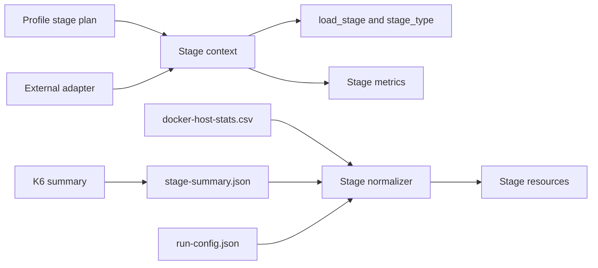

# Diseño De Stepped Capacity Discovery

## Overview

El diseño agrega un plan de stages enriquecido al perfil, una capa core para resolver la etapa activa y métricas custom por etapa, y un normalizador Node.js para correlacionar las ventanas con el collector de Docker. El adapter solo consume el contrato; no se agregan datos de una aplicación concreta al framework.

## Architecture



El profile es la fuente de verdad. Sus definiciones contienen `id`, `type`, `target`, `duration`, `start_seconds` y `end_seconds`. El escenario k6 recibe únicamente `target` y `duration`, evitando enviar campos no soportados por el executor.

## Components and Interfaces

### `k6/core/stages/context.js`

- Configura métricas custom para cada stage.
- Resuelve la etapa activa usando el inicio del escenario y offsets del perfil.
- Agrega `load_stage` y `stage_type` a tags de requests y journeys.
- Registra iteraciones, requests, checks, errores, duración y VUs.

### `k6/core/stages/summary.js`

- Convierte métricas custom en un contrato normalizado.
- Calcula `actual_iterations_per_second` y `requests_per_second` desde counts y duración.
- Calcula `dropped_iterations` solo para measurement mediante diferencia contra la carga esperada y marca el origen como derivado.

### `k6/scripts/normalize-stage-summary.mjs`

- Lee `stage-summary.json`, `run-config.json` y `docker-host-stats.csv`.
- Usa `run_started_at` y offsets de stage para seleccionar filas.
- Calcula recursos por contenedor o por rol configurado.
- No conoce nombres privados ni tecnologías específicas.

### Adapter contract

El adapter debe:

1. Obtener el profile mediante `getProfile`.
2. Invocar `configureStages(profile)` antes de ejecutar journeys.
3. Usar `request` y `journeyTags` del core cuando corresponda.
4. Invocar `createStageSummary` desde `handleSummary`.

## Data Models

### Stage definition

```json
{
  "id": "hold_20",
  "type": "measurement",
  "target": 20,
  "duration": "3m",
  "duration_seconds": 180,
  "start_seconds": 150,
  "end_seconds": 330
}
```

### Stage summary

El artefacto contiene todas las etapas y una lista `measurement_stages`. Solo las etapas con `type=measurement` se consideran para la capacidad sostenida.

### Resource correlation

Los servicios se indexan por nombre configurado o por rol definido en `CONTAINER_ROLES_JSON`. El core no contiene nombres de containers de aplicaciones.

## API Contracts

La CLI mantiene:

```bash
./nxp-performance run <project> capacity-stepped
```

Variables relevantes:

- `ADAPTER_PATH`: ruta externa al entrypoint k6.
- `DOCKER_CONTAINERS`: lista de contenedores a observar.
- `CONTAINER_ROLES_JSON`: mapa opcional rol a contenedor.
- `CAPACITY_STEPPED_STAGE_PLAN_JSON`: plan alternativo serializado.
- `CAPACITY_STEPPED_PRE_ALLOCATED_VUS`: VUs preasignadas.
- `CAPACITY_STEPPED_MAX_VUS`: límite máximo de VUs.

## Error Handling

- Una etapa sin duración válida detiene la carga antes de ejecutar.
- Una métrica ausente se serializa como `null`.
- Un collector sin filas no produce correlación falsa.
- El normalizador no elimina ni sobrescribe resultados previos.
- El orchestrator elimina solo su contenedor k6 configurado al finalizar.

## Testing Strategy

- `npm run build` para validar TypeScript y build del dashboard.
- `npm test` para regresión del framework.
- `k6 inspect` con el adapter de referencia y el adapter externo.
- Validación del collector en una ejecución corta.
- Prueba real stepped únicamente después de prechecks completos.
- Privacy scan sobre archivos públicos antes del run.

## Decisiones Técnicas

- Se usan métricas custom por stage porque el resumen agregado de k6 no permite recuperar percentiles independientes de forma confiable solo desde `summary.json`.
- Se mantienen `preAllocatedVUs=30` y `maxVUs=100`: el run anterior alcanzó 40 iteraciones por segundo sin dropped iterations y con latencia baja; conservar margen evita que el generador sea el límite al probar 80.
- Los recursos se normalizan después de k6 porque el collector usa timestamps del host y necesita el `run_started_at` definitivo.

## Riesgos e Incertidumbres

- Un adapter que no utilice las utilidades core puede producir métricas de stage incompletas.
- `dropped_iterations` por measurement se deriva de la carga esperada y el count registrado; el valor global de k6 continúa siendo la referencia primaria.
- La clasificación de saturación requiere correlación y no depende de un único umbral universal.

## Correctness Properties

1. Las ventanas de stages son contiguas y no se solapan.
2. Una etapa `measurement` nunca incluye timestamps de una transición.
3. La suma de las duraciones del plan coincide con el final de la última etapa.
4. El normalizador no incorpora filas fuera de la ventana de la etapa.
