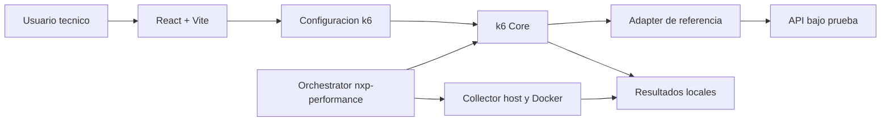

# NXP Performance Harness

Herramienta local para construir configuraciones de k6, ejecutar pruebas de rendimiento y revisar resultados de forma reproducible. Incluye una interfaz web React para configurar pruebas y visualizar resúmenes, un core reutilizable de k6 y un adapter de referencia para APIs HTTP.

## Overview

El proyecto reduce la edición manual de archivos JavaScript de k6 y centraliza la ejecución de workloads de rendimiento.

Actualmente soporta:

- Config Builder UI para crear configuraciones compatibles con k6.
- Performance Dashboard para revisar KPIs, thresholds y gráficos desde archivos JSON.
- Runner k6 reutilizable con perfiles, métricas, tags y reporting.
- Journeys de referencia para listar recursos, consultar detalles y validar flujos HTTP.
- Journeys opcionales de escritura y transacciones, deshabilitados por defecto.
- Ejecución local coordinada mediante collector de host y contenedor k6.
- Exportación de `summary.json`, `summary.html` y `run-config.json`.

La primera versión funciona localmente y no envía resultados a servicios externos.

## Architecture



Componentes principales:

- **Interfaz web:** React, TypeScript y Vite para configuración y visualización local.
- **Core k6:** perfiles de carga, wrappers HTTP, selección de datos, métricas y summaries.
- **Adapter de referencia:** journeys, datos de ejemplo y contratos HTTP genéricos.
- **Orchestrator:** `nxp-performance` coordina collector, k6, resultados y limpieza de procesos.
- **Observabilidad local:** `/proc`, `/proc/vmstat` y `docker stats`, sin Prometheus ni Grafana.

## Project Structure

```text
.
├── k6/
│   ├── core/                       # Componentes reutilizables de k6
│   ├── projects/reference/         # Adapter, datos y journeys genéricos
│   ├── profiles/                   # Perfiles del runner compatible
│   ├── scripts/                    # Runner y collectors locales
│   ├── config/                     # Configuracion del runner compatible
│   └── performancetest.js          # Runner compatible existente
├── src/                            # Aplicacion web React + TypeScript
├── tests/
│   ├── unit/                       # Pruebas unitarias
│   ├── properties/                 # Pruebas property-based
│   └── integration/                # Pruebas de integracion
├── examples/                       # Ejemplos de uso
├── .sdd/
│   ├── specs/                      # Requirements, design y tasks
│   ├── steering/                   # Reglas transversales
│   ├── skills/                     # Capacidades reutilizables
│   └── hooks/                      # Automatizaciones documentadas
├── nxp-performance                 # Orchestrator local
├── package.json
├── tsconfig.json
├── vite.config.ts
└── vitest.config.ts
```

## Technology Stack

| Componente | Tecnologia |
|---|---|
| Interfaz web | React 18, TypeScript, Vite |
| Pruebas automatizadas | Vitest, Testing Library, fast-check |
| Pruebas de rendimiento | k6 |
| Ejecucion aislada | Docker |
| Configuracion de pruebas | JavaScript y JSON |
| Graficos | Canvas/SVG y componentes propios |

## Prerequisites

- Node.js 18 o superior.
- npm.
- Docker Engine con acceso al daemon local.
- Una API bajo prueba accesible desde el host o desde la red configurada.
- k6 instalado localmente solo si se ejecuta directamente fuera del contenedor Docker.

El orchestrator utiliza por defecto la imagen Docker `grafana/k6`.

## Installation

```bash
git clone <url-del-repositorio>
cd nxp-performance-harness
npm install
```

## Configuration

La interfaz web almacena la configuración del usuario en IndexedDB del navegador. No guarda esa información en una base de datos del proyecto.

Variables principales del runner de referencia:

| Variable | Valor predeterminado | Uso |
|---|---|---|
| `PROFILE` | `smoke` | Perfil k6 seleccionado |
| `BASE_URL` | `http://localhost:8080` | URL base de la API bajo prueba |
| `RESULTS_DIR` | `results/reference/<run-id>` | Directorio de resultados |
| `RUN_ID` | Generado automáticamente | Identificador de ejecución |
| `K6_CONTAINER_NAME` | `nxp-k6-capacity` | Nombre determinista del contenedor k6 |
| `NXP_K6_IMAGE` | `grafana/k6` | Imagen Docker de k6 |
| `INITIAL_CAPTURE_SECONDS` | `10` | Captura inicial antes de iniciar k6 |

Los journeys de escritura y transacciones permanecen deshabilitados por defecto. No se deben incluir credenciales, tokens ni datos sensibles en archivos de configuración o resultados.

## Running The Project

### Interfaz web

```bash
npm run dev
```

La interfaz queda disponible en `http://localhost:5173`.

### Build y preview

```bash
npm run build
npm run preview
```

### Runner de referencia directo

El smoke local utiliza el runner reusable:

```bash
PROFILE=smoke \
BASE_URL=http://localhost:8080 \
bash k6/scripts/run-reference.sh
```

Un baseline de arrival rate puede ejecutarse así:

```bash
PROFILE=baseline \
BASE_URL=http://localhost:8080 \
BASELINE_RATE=1 \
BASELINE_DURATION=5m \
bash k6/scripts/run-reference.sh
```

### Capacity discovery local

El perfil `capacity-discovery` representa un:

```text
UNCONSTRAINED LOCAL CAPACITY DISCOVERY
```

No aplica límites de CPU o RAM y no representa sizing productivo.

El comando coordinado es:

```bash
./nxp-performance run reference capacity-discovery
```

El perfil utiliza:

```text
startRate: 3
timeUnit: 1s
preAllocatedVUs: 30
maxVUs: 100
```

Stages:

```text
3 iter/s   2m
5 iter/s   3m
10 iter/s  3m
20 iter/s  4m
40 iter/s  4m
```

El orchestrator genera un nombre fijo para k6:

```text
nxp-k6-capacity
```

## Results

Cada ejecución coordinada produce:

```text
results/
└── reference/
    └── <run-id>-capacity-discovery/
        ├── summary.json
        ├── summary.html
        ├── run-config.json
        └── docker-host-stats.csv
```

`run-config.json` incluye información no sensible del host:

- modelo de CPU;
- cantidad de CPUs lógicas;
- memoria total;
- sistema operativo;
- kernel;
- versión de Docker;
- driver de almacenamiento de Docker;
- nombre del contenedor k6;
- tipo de ejecución.

`docker-host-stats.csv` registra CPU, memoria, PIDs, load average, iowait y actividad de swap del host y de los contenedores observados.

La métrica `host_swap_used_mib` representa swap ocupado. `host_swap_in` y `host_swap_out` representan actividad durante el intervalo de muestreo. Un valor de swap ocupado mayor que cero no implica por sí solo saturación.

## Docker CPU Interpretation

En Linux, `docker stats` expresa el CPU del contenedor aproximadamente en relación con una CPU completa:

```text
100%  ≈ 1 CPU/core
200%  ≈ 2 CPUs
400%  ≈ 4 CPUs
1600% ≈ 16 CPUs lógicas
```

El valor no debe interpretarse como porcentaje de toda la workstation. La interpretación de resultados también debe considerar que k6 y el sistema bajo prueba pueden compartir el mismo hardware local.

## Testing

```bash
npm test
npm run build
npm run test:coverage
```

Pruebas por grupo:

```bash
npx vitest --run tests/unit/
npx vitest --run tests/properties/
npx vitest --run tests/integration/
```

La configuración de k6 puede inspeccionarse sin ejecutar carga:

```bash
docker run --rm \
  --user "$(id -u):$(id -g)" \
  --network host \
  -v "$PWD:/work" \
  -w /work \
  grafana/k6 inspect \
  --env PROFILE=capacity-discovery \
   k6/projects/reference/main.js
```

## Security

- La ejecución y los resultados permanecen locales.
- No se almacenan credenciales, tokens, secretos ni datos de tarjeta en el repositorio.
- Las operaciones de escritura y transacciones están deshabilitadas por defecto.
- Las variables sensibles deben proporcionarse fuera de archivos versionados.
- Los resultados de rendimiento pueden contener URLs y datos operativos; deben tratarse como información interna.
- El collector solo lee `/proc`, `/proc/vmstat` y estadísticas Docker; no modifica la aplicación bajo prueba.

## Documentation

La documentación técnica se organiza en `.sdd/`:

- [Steering](.sdd/steering/): reglas de producto, arquitectura, idioma y tecnología.
- [Specs](.sdd/specs/): requirements, design y tasks por funcionalidad.
- [Skills](.sdd/skills/): instrucciones operativas reutilizables.
- [Hooks](.sdd/hooks/): automatizaciones y validaciones documentadas.
- [Estado actual de k6](.sdd/docs/k6-current-state.md).
- [Catálogo de métricas](.sdd/docs/metrics-catalog.md).

Specs principales:

- [Config Builder UI](.sdd/specs/config-builder-ui/requirements.md).
- [Performance Dashboard](.sdd/specs/performance-dashboard/requirements.md).
- [k6 Config Contract](.sdd/specs/k6-config-contract/requirements.md).
- [k6 Summary Export](.sdd/specs/k6-summary-export/requirements.md).
- [Adapter de referencia para APIs](.sdd/specs/reference-api-adapter/requirements.md).
- [Orchestrator de capacity discovery](.sdd/specs/capacity-discovery-orchestrator/requirements.md).
- [Collector de observabilidad local](.sdd/specs/host-observability-collector/requirements.md).

## Contributing

- Mantener la separación entre la interfaz web, el core k6 y los adapters de referencia.
- Mantener los cambios trazables a la spec correspondiente en `.sdd/specs/`.
- Ejecutar `npm test` y `npm run build` antes de solicitar revisión.
- No agregar secretos ni resultados sensibles al repositorio.
- Documentar cambios de contratos, perfiles o métricas en la documentación técnica correspondiente.
- Usar ramas de trabajo y revisión mediante Pull Request según las reglas del repositorio remoto.
